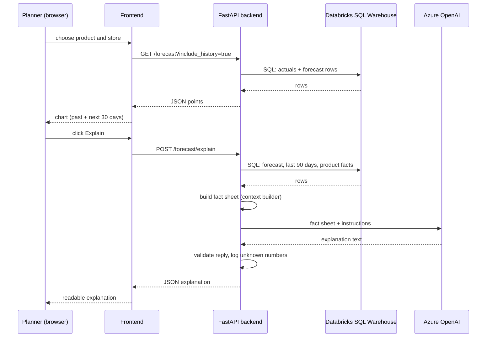

# Chapter 2: The big picture

> 🎯 **What you will learn**
> - Every box in the architecture, in plain words
> - The difference between a **logical** and a **physical** architecture
> - How one click on the dashboard travels through the whole system
> - Which chapter teaches which box

⏱️ Reading time: about 25 minutes. No code yet, just the map. Come back to this page whenever you feel lost.

---

## 🧸 A restaurant analogy

A restaurant has four jobs:

| Restaurant | Sales AI |
|---|---|
| **Suppliers** bring raw ingredients | **Input data**: four CSV files |
| The **kitchen** washes, chops and cooks | **Databricks**: cleans data and trains the model |
| The **waiter** takes your order and brings food | **Backend API**: fetches data and asks the AI |
| The **dining room** is what you see | **Frontend**: the screens people use |

Nobody eats in the kitchen, and the chef never talks to customers. Each part has **one job**. Splitting a system into parts with one job each is the main skill this book teaches.

---

## 🗺️ Two kinds of architecture drawing

Architects draw the same system twice, for two different questions.

| Drawing | Question it answers | Looks like |
|---|---|---|
| **Logical** | *What* does each part do? | Boxes named by job, no cloud brand names needed |
| **Physical** | *Where* does each part run? | Real Azure and Databricks services |

Start with the logical one.

### The logical architecture

Read it **left to right** in four zones:

1. **Input data** (blue, left): four CSV files with products, stores, calendar/marketing facts and sales.
2. **Databricks workflow** (red): one job that runs **seven notebooks** in order. Notebook `04 EDA` is a dashed side branch. It *looks* at the data and draws charts, but writes nothing the model uses.
3. **Backend API** (teal): a Python service with four internal parts: routes, a SQL module, a context builder, and a prompt orchestrator that calls Azure OpenAI.
4. **Frontends** (pink, right): two screens that do the same thing. One in React, one in Streamlit. Both talk to the **same** backend.

---

## 🔍 Every box, explained

### 1. Input data: four CSV files

| File | What it holds | Rows |
|---|---|---|
| `products.csv` | The product catalog (name, category, price, lifecycle) | 6 |
| `stores.csv` | The store network (city, size, type) | 8 |
| `calendar_marketing_external.csv` | One row per day: holidays, weather, promotions, ad spend, economy | 1,826 |
| `sales_transactions.csv` | What was actually sold, where and when | 84,928 |

Full detail in [Chapter 4](04-the-data.md).

### 2. The Databricks workflow: seven notebooks

A **notebook** is a document where code and explanation live together. A **workflow (job)** runs notebooks in a set order, like an assembly line.

| Notebook | Job | Layer | Chapter |
|---|---|---|---|
| `01_setup` | Create the catalog, schemas and storage volume | setup | [5](05-databricks-setup-and-bronze.md) |
| `02_bronze_ingestion` | Load raw CSVs into tables, **keep everything** | 🥉 Bronze | [5](05-databricks-setup-and-bronze.md) |
| `03_silver_transformation` | Fix types, remove duplicates, validate, join into one wide table | 🥈 Silver | [6](06-silver.md) |
| `04_exploratory_data_analysis` | Explore patterns with charts | side branch | [7](07-eda.md) |
| `05_gold_transformation` | Build ML-ready features (lags, rolling averages) | 🥇 Gold | [8](08-gold-features.md) |
| `06_model_training` | Train LightGBM, track in MLflow, promote the best | ML | [9](09-model-training.md), [10](10-registry-and-promotion.md) |
| `07_batch_inference` | Generate the 30-day forecast for every product and store | ML | [11](11-batch-inference.md) |

> 🧠 **Medallion architecture.** Bronze, Silver and Gold are like a water filter. Each layer is cleaner than the one before. Bronze keeps the raw data (so you can always go back), Silver is trusted and validated, Gold is shaped for one purpose: machine learning.

The data lives in **Unity Catalog**, Databricks' organiser. Every table has a three-part address: `catalog.schema.table`, for example `sales_ai.gold.forecast_results`.

### 3. The model registry

Every trained model is saved and versioned in the **MLflow Model Registry**. One version holds the alias **`Champion`**, the model currently used for forecasts. A new model must **beat** the Champion to take the title. See [Chapter 10](10-registry-and-promotion.md).

### 4. The backend API (FastAPI)

A Python web service that answers questions from the screens. It has twelve endpoints:

| Endpoint | In plain words |
|---|---|
| `GET /health` | "Are you alive?" |
| `GET /forecast` | Past sales and the 30-day forecast for one product and store |
| `GET /forecast/trend/all` | Every forecast, grouped by product |
| `POST /forecast/explain` | Plain-English explanation of one forecast |
| `GET /products`, `GET /stores` | Fill the drop-down lists |
| `POST /chat`, `POST /chat/quick` | Free-text question, and one-click questions |
| `GET /kpis` | Numbers for the KPI cards |
| `POST /pipeline/trigger` | Start the Databricks job |
| `GET /pipeline/status/{run_id}` | Is the job running, done, or failed? |
| `POST /pipeline/upload-and-trigger` | Upload new CSVs and start the job |

Inside the backend: a **SQL module** reads the Gold tables, a **context builder** turns real numbers into a small fact sheet, and **prompt orchestration** hands that fact sheet to Azure OpenAI. See [Chapters 12](12-backend-fastapi.md) and [13](13-genai.md).

### 5. Azure OpenAI (the LLM)

A large language model hosted in your own Azure account. It receives the fact sheet and writes the explanation. It **never** receives a raw database and is **never** asked to calculate a forecast.

### 6. The frontends

| Frontend | Built with | Best for |
|---|---|---|
| **A: React** | React, TypeScript, Vite, served by Nginx | Teams who want a polished web app |
| **B: Streamlit** | Python only | People who know Python and want a screen fast |

Both call the same REST API, so you can learn from either one, or compare them.

---

## 🚶 Follow one click through the system

**Scenario:** a planner picks *Electronics* and *Mumbai Flagship 01*, then clicks **Explain**.

> The diagram above is drawn with Mermaid, which GitHub and the book website both render automatically. If you only see code, view it on GitHub or the published site.

Two things to notice:

1. The **frontend never touches the database or the AI directly**. Only the backend holds secrets (tokens, keys). This is a basic security rule: secrets must never reach the browser.
2. The backend **protects the numbers**. The summary figures in the response are copied from the fact sheet, never from the AI's text. The AI's answer must be valid JSON (one retry, then a safe template), and any number in it that is not in the fact sheet is logged as a warning. You will read this code in Chapter 13.

---

## ☁️ The physical architecture

Now the same system, with the real services it runs on.

| Zone | Service | What it does |
|---|---|---|
| **Source control** | GitHub | Stores the code |
| **CI/CD** | Azure DevOps Pipelines | On every push: build backend image, build frontend image, deploy the Databricks bundle |
| **Image storage** | Azure Container Registry (ACR) | A private shelf for Docker images |
| **App hosting** | Azure Container Apps | Runs the backend and frontend containers; gives them HTTPS addresses |
| **AI** | Azure OpenAI | The language model |
| **Data and ML** | Databricks workspace | Workflows, Unity Catalog, SQL Warehouse, MLflow registry |

Three new words:

- **Container** (Docker): your app packed together with everything it needs, so it runs the same everywhere. Like a lunchbox: the same meal, wherever you open it.
- **CI/CD**: *Continuous Integration / Continuous Delivery*. Robots that test, build and deploy your code every time you push, so nobody deploys by hand at 2 a.m.
- **Bundle** (Databricks Asset Bundle): your Databricks notebooks and job described in files, so they can be deployed by a robot too.

---

## 🧩 Why split it this way?

| Design choice | Why |
|---|---|
| Databricks does data and ML; the backend only *reads* results | Heavy work runs in batch. Screens stay fast. |
| One backend, two frontends | A new screen costs days, not months. The logic lives in one place. |
| LLM only explains | Numbers stay traceable. No invented figures. |
| Model registry with `Champion` | You always know which model made a forecast, and can roll back. |
| Everything in containers and bundles | Reproducible and automatable. |

---

## ✅ Checkpoint

Close the page and try to answer:

1. Which notebook is *not* needed by the model? *(Answer: `04` EDA)*
2. Which part holds the secret keys? *(Answer: the backend)*
3. What would break if the frontend called Azure OpenAI directly? *(Answer: the key would be exposed in the browser)*
4. What does the `Champion` alias mean?

---

## 🔗 Learn more

- [Medallion architecture (Databricks)](https://www.databricks.com/glossary/medallion-architecture)
- [What is Unity Catalog? (Microsoft Learn)](https://learn.microsoft.com/azure/databricks/data-governance/unity-catalog/)
- [MLflow Model Registry](https://mlflow.org/docs/latest/model-registry.html)
- [FastAPI: first steps](https://fastapi.tiangolo.com/tutorial/first-steps/)
- [Azure Container Apps overview](https://learn.microsoft.com/azure/container-apps/overview)
- [Azure OpenAI overview](https://learn.microsoft.com/azure/ai-services/openai/overview)

⬅️ [Chapter 1](01-business-problem.md) · ➡️ **Next:** [Chapter 3: Setup, tools and costs](03-setup-and-costs.md)
