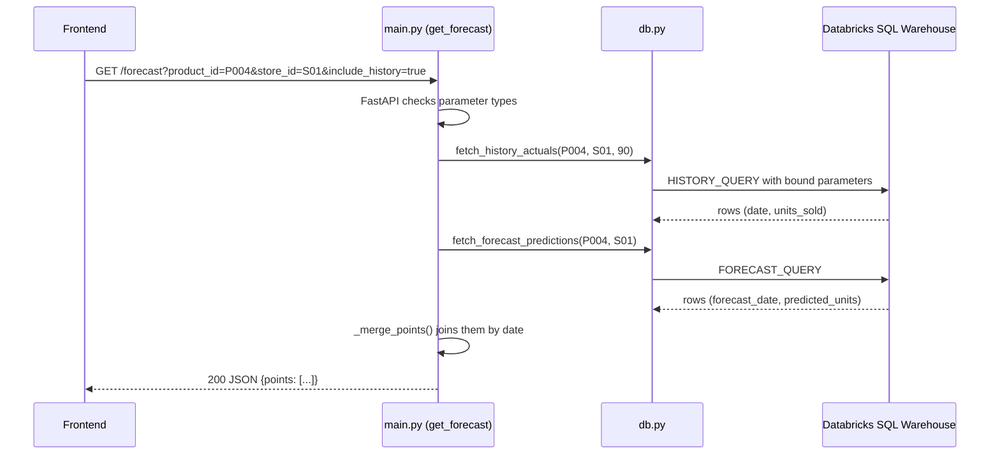

# Chapter 12: The backend with FastAPI

> 🎯 **What you will learn**
> - What an **API** is, and why this project needs one between the screens and the data
> - How FastAPI turns a Python function into a web address
> - The 12 endpoints, what each one returns, and which tables it reads
> - How the data layer is split into small files with one job each
> - How errors become clear HTTP status codes instead of crashes
> - How to try every endpoint yourself, with and without Databricks

⏱️ Time: about 90 minutes. You do not need to know FastAPI. We explain every file.

---

## 🧸 The waiter analogy

In [Chapter 2](02-big-picture.md) we said the backend is the **waiter**.

| Restaurant | Backend |
|---|---|
| The customer reads the **menu** | The frontend shows buttons and drop-downs |
| The waiter knows the menu and **checks the order** ("we have no pizza at lunch") | FastAPI checks every request (wrong type? missing value?) |
| The waiter goes to the **kitchen** and brings food | The backend runs SQL on Databricks and calls Azure OpenAI |
| The waiter never lets the customer into the **safe** | Only the backend holds the passwords and keys |

An **API** (Application Programming Interface) is that menu: a list of things a program may ask for, and the exact shape of the answer. Ours is a **REST API**: each thing has an address (a URL), and the answer is **JSON**, a simple text format of names and values.

```json
{"product_id": "P004", "store_id": "S01", "history_days": 90, "points": [ ... ]}
```

---

## 🗺️ The layers


Every file has **one job**. This is the most useful idea in the chapter.

| File | Job | Never does |
|---|---|---|
| `main.py` | The front door: routes, input checks, error codes | Write SQL |
| `src/models/schemas.py` | The *shape* of every request and response | Talk to a database |
| `src/data/db.py` | Named SQL queries, run safely | Decide what an answer means |
| `src/data/analytics.py` | Business questions: rounding, percentages, thresholds | Touch HTTP |
| `src/data/databricks_client.py` | Opens the SQL connection from `.env` | Run business logic |
| `src/data/databricks_jobs.py` | Upload files, start and watch the Databricks job | Run SQL |
| `src/genai/*` | Explain and chat with Azure OpenAI ([Chapter 13](13-genai.md)) | Hold the numbers' source of truth |

```text
backend/
├── main.py                       ← run this
├── requirements.txt
├── pyproject.toml
├── Dockerfile
├── API_TESTING_EXAMPLES.md       ← more ready-made test calls
└── src/
    ├── models/schemas.py
    ├── data/
    │   ├── databricks_client.py
    │   ├── db.py
    │   ├── analytics.py
    │   ├── databricks_jobs.py
    │   ├── forecast_results_loader.py   (helper, not used by main.py)
    │   └── test_connection.py           (helper script)
    └── genai/
        ├── llm_client.py
        ├── explain_context.py
        ├── forecast_explainer.py
        └── chatbot.py
```

---

## 🚪 The 12 endpoints

An **endpoint** is one address plus one HTTP method. `GET` means "give me something". `POST` means "here is some data, do something".

| # | Method and path | What it does | Reads |
|---|---|---|---|
| 1 | `GET /health` | Is the API alive and can it reach Databricks? | `SELECT 1` |
| 2 | `GET /forecast` | Forecast rows, **or** history + forecast on one timeline (`include_history=true`) | `gold.forecast_results`, `gold.sales_features` |
| 3 | `GET /forecast/trend/all` | Every forecast row, grouped by product | `gold.forecast_results` |
| 4 | `POST /forecast/explain` | Plain-English explanation of one forecast | Gold tables + Silver products + Azure OpenAI |
| 5 | `GET /products` | Drop-down list | `silver.products` |
| 6 | `GET /stores` | Drop-down list | `silver.stores` |
| 7 | `POST /chat` | Free-text question, AI chooses data tools | Gold + Silver + Azure OpenAI |
| 8 | `POST /chat/quick` | One-click question, **no AI** | Gold + Silver |
| 9 | `GET /kpis` | Four numbers for the KPI cards | Gold + Silver |
| 10 | `POST /pipeline/trigger` | Start the Databricks job | Jobs API |
| 11 | `GET /pipeline/status/{run_id}` | Is that run finished? | Jobs API |
| 12 | `POST /pipeline/upload-and-trigger` | Upload CSVs, then start the job | Files API + Jobs API |


---

## ⏱️ Life of one request

Follow `GET /forecast?product_id=P004&store_id=S01&include_history=true`.




---

## 🛠️ Run it

You did this in [Chapter 3](03-setup-and-costs.md). Short version:

```bash
cd backend
python -m venv .venv && source .venv/bin/activate     # Windows: .venv\Scripts\Activate.ps1
pip install -r requirements.txt
python main.py
```

Then open **<http://localhost:8000/docs>**. FastAPI built this page for you from the code. Every endpoint can be tried with **Try it out → Execute**.

> 🧪 **No Databricks yet?** Run the mock instead: `python tools/mock_backend.py` from the repository root. It has the **same 12 addresses and the same JSON shapes**, built from the CSV files in `data/`. `/health` says `MOCK MODE`, and its forecast is a plain weekday average, not the real model.

---

## 📖 `main.py`, section by section

### 1. Imports, logging and the app object

```python
"""FastAPI microservice serving retail sales forecasts from Databricks."""

import logging
import os
from datetime import datetime
from typing import List, Optional, Union

from fastapi import FastAPI, File, HTTPException, Query, UploadFile
from fastapi.middleware.cors import CORSMiddleware

from src.data import analytics, databricks_jobs
from src.data.databricks_jobs import DatabricksJobsConfigError
from src.data.db import (
    check_connection,
    fetch_distinct_products,
    fetch_forecast_predictions,
    fetch_forecasts,
    fetch_history_actuals,
    fetch_product_static,
    fetch_products,
    fetch_recent_sales_features,
    fetch_stores,
)
from src.genai.chatbot import QUICK_ACTIONS, run_chat, run_quick_action
from src.genai.explain_context import build_forecast_context
from src.genai.forecast_explainer import generate_explanation
from src.genai.llm_client import LLMConfigError
from src.models.schemas import (
    ChatRequest,
    ChatResponse,
    ExplainRequest,
    ExplainResponse,
    ForecastListResponse,
    ForecastPoint,
    ForecastRecord,
    ForecastSummary,
    ForecastTrendResponse,
    HealthResponse,
    KPISummary,
    PipelineStatusResponse,
    PipelineTriggerResponse,
    PipelineUploadAndTriggerResponse,
    PredictedRevenueStat,
    Product,
    ProductForecastGroup,
    QuickActionRequest,
    Store,
    TopCategoryStat,
    TopProductStat,
    UploadedFileInfo,
)

logging.basicConfig(level=logging.INFO)
logger = logging.getLogger("sales_forecasting_api")

app = FastAPI(
    title="Sales Forecasting API",
    description="Serves retail sales forecast data from the Databricks gold layer (sales_ai.gold.forecast_results).",
    version="0.1.0",
)
```

- `FastAPI(...)` creates the application. The `title`, `description` and `version` appear on the `/docs` page.
- `logging` writes technical details **to the server log**. We will see why in the error section.
- Notice the imports: `main.py` imports *functions* (`fetch_forecasts`) and *models* (`ForecastRecord`). It never imports SQL text.

### 2. CORS: letting the browser call us

```python
# Allows the separately-deployed frontend (Vite dev server locally, or a
# different origin/domain in production) to call this API from the browser.
# Configurable via CORS_ALLOW_ORIGINS (comma-separated) since frontend and
# backend can be deployed to different hosts.
allowed_origins = os.environ.get("ALLOWED_ORIGINS", "http://localhost:5173").split(",")

app.add_middleware(
    CORSMiddleware,
    allow_origins=allowed_origins,
    allow_credentials=True,
    allow_methods=["*"],
    allow_headers=["*"],
)
```

Browsers have a safety rule: a page from one address (`localhost:5173`) may not call another address (`localhost:8000`) unless the second one allows it. This is **CORS** (Cross-Origin Resource Sharing).

- `ALLOWED_ORIGINS` is a comma-separated list in `.env`. Default: the React dev server.
- For Streamlit you do **not** need CORS: Streamlit's Python code calls the backend from the server, not from the browser. (We still list `8501` in `.env.example` so a browser-based tool would also work.)
- If a frontend shows a CORS error, add its address to `ALLOWED_ORIGINS` and restart.

> 📝 The comment above the line mentions a variable called `CORS_ALLOW_ORIGINS`. The code really reads **`ALLOWED_ORIGINS`**. Trust the code, not the old comment.

### 3. `GET /health`

```python
@app.get(
    "/health",
    response_model=HealthResponse,
    summary="Health check",
    description="Confirms the API is running and can reach the Databricks SQL warehouse.",
)
def health() -> HealthResponse:
    try:
        check_connection()
    except Exception:
        logger.exception("Databricks health check failed")
        raise HTTPException(
            status_code=500,
            detail="API is up but the Databricks connection check failed. Check server logs for details.",
        )

    return HealthResponse(status="okay I'm, ready to serve you!!", databricks_connected=True)
```

The decorator `@app.get("/health", response_model=HealthResponse)` is the magic line. It says: *when someone sends GET to /health, run the function below, and make the answer fit HealthResponse*.

`check_connection()` runs `SELECT 1`. If Databricks is unreachable, the function raises, we log the details, and the caller gets a clean `500` with a safe message.

### 4. `GET /forecast`, two modes in one endpoint

```python
def _to_date(value):
    """Normalize a date/datetime value from the connector to a plain date.

    forecast_date comes back as a TIMESTAMP (datetime) while sales_features.date
    comes back as a DATE (date) -- both are normalized here so they compare and
    sort correctly as dict keys.
    """

    return value.date() if isinstance(value, datetime) else value


def _merge_points(history_rows: list[dict], forecast_rows: list[dict]) -> List[ForecastPoint]:
    """Merge sales_features actuals and forecast_results predictions into one
    chronological timeline, keyed by date."""

    points: dict = {}

    for row in history_rows:
        row_date = _to_date(row["date"])
        points[row_date] = ForecastPoint(date=row_date, actual_units=row["units_sold"], predicted_units=None)

    for row in forecast_rows:
        forecast_date = _to_date(row["forecast_date"])
        existing = points.get(forecast_date)
        if existing is not None:
            existing.predicted_units = row["predicted_units"]
        else:
            points[forecast_date] = ForecastPoint(
                date=forecast_date, actual_units=None, predicted_units=row["predicted_units"]
            )

    return [points[key] for key in sorted(points)]
```

- `_to_date` fixes a small difference: forecast dates arrive as *timestamps*, history dates as *dates*. Without this, the same day would be two different dictionary keys.
- `_merge_points` builds one timeline. Think of two lists written on index cards. The actual-sales cards and the forecast cards are put into one dictionary **keyed by date**. If both exist for a date, one card gets both values. Finally the dates are sorted.

```python
def get_forecast(
    product_id: Optional[str] = Query(None, description="Filter by product ID"),
    store_id: Optional[str] = Query(None, description="Filter by store ID"),
    category: Optional[str] = Query(None, description="Filter by product category (ignored when include_history=true)"),
    include_history: bool = Query(False, description="Merge in historical actuals alongside the forecast"),
    history_days: int = Query(
        90, ge=1, description="Days of history to include; only used when include_history=true"
    ),
) -> Union[ForecastListResponse, ForecastTrendResponse]:
    if include_history:
        if not product_id or not store_id:
            raise HTTPException(
                status_code=400,
                detail="include_history=true requires both product_id and store_id.",
            )

        try:
            history_rows = fetch_history_actuals(product_id, store_id, history_days)
            forecast_rows = fetch_forecast_predictions(product_id, store_id)
        except Exception:
            logger.exception("Failed to build forecast trend")
            raise HTTPException(
                status_code=500,
                detail="Failed to fetch trend data from Databricks. Check server logs for details.",
            )

        return ForecastTrendResponse(
            product_id=product_id,
            store_id=store_id,
            history_days=history_days,
            points=_merge_points(history_rows, forecast_rows),
        )

    try:
        rows = fetch_forecasts(product_id=product_id, store_id=store_id, category=category)
    except Exception:
        logger.exception("Failed to query forecast_results")
        raise HTTPException(
            status_code=500,
            detail="Failed to fetch forecast data from Databricks. Check server logs for details.",
        )

    records = [ForecastRecord(**row) for row in rows]
    return ForecastListResponse(count=len(records), results=records)
```

| Piece | Meaning |
|---|---|
| `Optional[str] = Query(None, ...)` | An optional address parameter, with help text for `/docs` |
| `history_days: int = Query(90, ge=1)` | Must be a whole number, at least 1. Otherwise FastAPI answers `422` before our code runs |
| `include_history=true` | Needs **both** ids, else `400 Bad Request` |
| `response_model=Union[...]` | Two possible answer shapes; FastAPI validates whichever one we return |

### 5. `POST /forecast/explain`

```python
def explain_forecast(request: ExplainRequest) -> ExplainResponse:
    try:
        forecast_rows = fetch_forecasts(product_id=request.product_id, store_id=request.store_id)
    except Exception:
        logger.exception("Failed to fetch forecast_results for explanation")
        raise HTTPException(
            status_code=500,
            detail="Failed to fetch forecast data from Databricks. Check server logs for details.",
        )

    if not forecast_rows:
        raise HTTPException(
            status_code=404,
            detail=f"No forecast found for product_id={request.product_id!r}, store_id={request.store_id!r}.",
        )

    try:
        recent_rows = fetch_recent_sales_features(request.product_id, request.store_id, days=90)
    except Exception:
        logger.exception("Failed to fetch sales_features history for explanation")
        raise HTTPException(
            status_code=500,
            detail="Failed to fetch historical data from Databricks. Check server logs for details.",
        )

    if not recent_rows:
        raise HTTPException(
            status_code=404,
            detail=(
                f"No historical data found for product_id={request.product_id!r}, "
                f"store_id={request.store_id!r}."
            ),
        )

    try:
        product_static = fetch_product_static(request.product_id)
    except Exception:
        logger.exception("Failed to fetch product attributes for explanation")
        raise HTTPException(
            status_code=500,
            detail="Failed to fetch product attributes from Databricks. Check server logs for details.",
        )

    context = build_forecast_context(
        product_id=request.product_id,
        store_id=request.store_id,
        forecast_rows=forecast_rows,
        recent_features_rows=recent_rows,
        product_static=product_static,
    )

    try:
        narrative = generate_explanation(context, request.user_question)
    except LLMConfigError as exc:
        logger.error("Azure OpenAI is not configured: %s", exc)
        raise HTTPException(status_code=503, detail=f"GenAI explanation service is not configured: {exc}")
    except Exception:
        logger.exception("Azure OpenAI call failed")
        raise HTTPException(
            status_code=503,
            detail="GenAI explanation service is currently unreachable. Please try again shortly.",
        )

    return ExplainResponse(
        product_id=request.product_id,
        store_id=request.store_id,
        forecast_summary=ForecastSummary(
            avg_predicted_units=context["avg_predicted_units"],
            total_predicted_units=context["total_predicted_units"],
            vs_recent_history_pct_change=context["vs_recent_history_pct_change"],
        ),
        explanation=narrative["explanation"],
        key_drivers=narrative["key_drivers"],
        risks_or_opportunities=narrative["risks_or_opportunities"],
        recommendation=narrative["recommendation"],
        model_version=str(context["model_version"]),
    )
```

This function is the best example of the backend's style. It is a **recipe in five steps**:

1. Get the forecast rows. None? `404`.
2. Get the last 90 days of history. None? `404`.
3. Get the product's fixed attributes.
4. Build the **fact sheet** (`build_forecast_context`).
5. Ask Azure OpenAI to write the words (`generate_explanation`), then build the response.

Look at the very end: `forecast_summary` is filled from `context[...]`, the **computed fact sheet**, and *not* from the AI's text. That is how the project keeps numbers trustworthy. Details in [Chapter 13](13-genai.md).

`request: ExplainRequest` means the body must be JSON like `{"product_id": "P004", "store_id": "S01", "user_question": null}`.

### 6. Lists, chat and KPIs

```python
@app.get(
    "/products",
    response_model=List[Product],
    summary="List all products",
    description="Returns every product from sales_ai.silver.products, for populating a product selector.",
)
def get_products() -> List[Product]:
    try:
        rows = fetch_products()
    except Exception:
        logger.exception("Failed to fetch products")
        raise HTTPException(
            status_code=500,
            detail="Failed to fetch products from Databricks. Check server logs for details.",
        )

    return [Product(**row) for row in rows]


@app.get(
    "/stores",
    response_model=List[Store],
    summary="List all stores",
    description="Returns every store from sales_ai.silver.stores, for populating a store selector.",
)
def get_stores() -> List[Store]:
    try:
        rows = fetch_stores()
    except Exception:
        logger.exception("Failed to fetch stores")
        raise HTTPException(
            status_code=500,
            detail="Failed to fetch stores from Databricks. Check server logs for details.",
        )

    return [Store(**row) for row in rows]
```

`return [Product(**row) for row in rows]` means: take each dictionary and make a validated `Product` from it. `**row` spreads the dictionary into named arguments.

```python
def chat(request: ChatRequest) -> ChatResponse:
    history = [{"role": turn.role, "content": turn.content} for turn in request.history]

    try:
        result = run_chat(
            request.message,
            history=history,
            store_id=request.store_id,
            store_name=request.store_name,
        )
    except LLMConfigError as exc:
        logger.error("Azure OpenAI is not configured: %s", exc)
        raise HTTPException(status_code=503, detail=f"Chat service is not configured: {exc}")
    except Exception:
        logger.exception("Chat request failed")
        raise HTTPException(
            status_code=503,
            detail="Chat service is currently unreachable. Please try again shortly.",
        )

    return ChatResponse(**result)
```

`/chat` turns the incoming history into plain dictionaries, calls `run_chat`, and returns the result. A **missing configuration** (`LLMConfigError`) becomes `503 Service Unavailable` with a message that names what is missing. Any other failure also becomes `503`.

```python
def chat_quick(request: QuickActionRequest) -> ChatResponse:
    try:
        result = run_quick_action(request.action, request.params)
    except ValueError as exc:
        raise HTTPException(status_code=400, detail=str(exc))
    except KeyError as exc:
        raise HTTPException(status_code=400, detail=f"Missing required param: {exc}")
    except Exception:
        logger.exception("Quick action failed: action=%s params=%s", request.action, request.params)
        raise HTTPException(
            status_code=500,
            detail="Failed to compute that answer from Databricks. Check server logs for details.",
        )

    return ChatResponse(**result)
```

`/chat/quick` has **no AI**. `ValueError` (unknown action) and `KeyError` (missing parameter) are caller mistakes, so they become `400`. Everything else is `500`.

```python
def get_kpis() -> KPISummary:
    try:
        summary = analytics.get_kpi_summary()
    except Exception:
        logger.exception("Failed to compute KPI summary")
        raise HTTPException(
            status_code=500,
            detail="Failed to compute KPI summary from Databricks. Check server logs for details.",
        )

    return KPISummary(
        top_category=TopCategoryStat(**summary["top_category"]),
        top_product=TopProductStat(**summary["top_product"]),
        predicted_revenue=PredictedRevenueStat(**summary["predicted_revenue"]),
        at_risk_count=summary["at_risk_count"],
    )
```

### 7. The pipeline endpoints

```python
ALLOWED_UPLOAD_PREFIXES = ("sales_transactions", "calendar_marketing_external")


def _validate_upload_filename(filename: Optional[str]) -> str:
    """Enforce what the Bronze notebook expects: a CSV whose filename starts
    with one of the recognized prefixes. Raises HTTPException(400) otherwise."""

    if not filename:
        raise HTTPException(status_code=400, detail="No filename provided.")
    if not filename.lower().endswith(".csv"):
        raise HTTPException(status_code=400, detail="Only CSV files are accepted.")
    if not filename.startswith(ALLOWED_UPLOAD_PREFIXES):
        raise HTTPException(
            status_code=400,
            detail=(
                f"Filename must start with one of {ALLOWED_UPLOAD_PREFIXES} -- "
                "that's what the Bronze notebook expects."
            ),
        )
    return filename


async def _upload_pipeline_files(files: List[UploadFile]) -> List[UploadedFileInfo]:
    """Upload logic for /pipeline/upload-and-trigger.

    Supports one or more files in a single request (e.g. a sales_transactions
    file and a calendar_marketing_external file together, or just one --
    whichever data is available). Every filename is validated up front, before
    anything is uploaded, so a bad file in the batch fails the whole request
    rather than leaving a partial upload. Raises HTTPException on failure.
    """

    if not files:
        raise HTTPException(status_code=400, detail="No files provided.")

    for file in files:
        _validate_upload_filename(file.filename)

    uploaded: List[UploadedFileInfo] = []
    for file in files:
        content = await file.read()
        try:
            volume_path = databricks_jobs.upload_file_to_volume(file.filename, content)
        except DatabricksJobsConfigError as exc:
            logger.error("Pipeline upload is not configured: %s", exc)
            raise HTTPException(status_code=503, detail=f"Pipeline upload is not configured: {exc}")
        except Exception:
            logger.exception("Failed to upload pipeline file %s to Databricks Volume", file.filename)
            raise HTTPException(
                status_code=502,
                detail=f"Failed to upload {file.filename} to Databricks. Check server logs for details.",
            )
        uploaded.append(UploadedFileInfo(filename=file.filename, volume_path=volume_path))

    return uploaded


def _trigger_pipeline_job() -> int:
    """Shared trigger logic for /pipeline/trigger and /pipeline/upload-and-trigger.
    Returns the new run_id. Raises HTTPException on failure."""

    try:
        return databricks_jobs.trigger_job()
    except DatabricksJobsConfigError as exc:
        logger.error("Pipeline trigger is not configured: %s", exc)
        raise HTTPException(status_code=503, detail=f"Pipeline trigger is not configured: {exc}")
    except Exception:
        logger.exception("Failed to trigger Databricks job")
        raise HTTPException(
            status_code=502,
            detail="Failed to trigger the pipeline job. Check server logs for details.",
        )
```

- `_validate_upload_filename` is the bouncer: CSV only, and the name must start with a known prefix. **Every** file is checked **before** any is uploaded, so a bad file never leaves a half-finished upload.
- `502 Bad Gateway` means "a service **behind** me (Databricks) failed". `503` means "I am not configured, or the service I depend on is unreachable".
- `_trigger_pipeline_job()` is shared by two endpoints, which is why it is a separate function.

```python
@app.post(
    "/pipeline/trigger",
    response_model=PipelineTriggerResponse,
    summary="Trigger the data pipeline job (run-now, no new file)",
    description=(
        "Triggers a run-now on DATABRICKS_JOB_ID against whatever files are already in "
        "the Volume -- no upload needed. Use this to re-run the pipeline without "
        "supplying new data. Returns immediately with the new run_id; poll "
        "GET /pipeline/status/{run_id} for progress."
    ),
)
def trigger_pipeline() -> PipelineTriggerResponse:
    run_id = _trigger_pipeline_job()
    return PipelineTriggerResponse(run_id=run_id)


@app.get(
    "/pipeline/status/{run_id}",
    response_model=PipelineStatusResponse,
    summary="Check a pipeline run's status",
    description=(
        "Returns the run's life_cycle_state (e.g. PENDING, RUNNING, TERMINATED) and, once "
        "TERMINATED, its result_state (e.g. SUCCESS, FAILED) and state_message. Meant to "
        "be polled every few seconds by the frontend until the run reaches a terminal state."
    ),
)
def get_pipeline_status(run_id: int) -> PipelineStatusResponse:
    try:
        status = databricks_jobs.get_run_status(run_id)
    except DatabricksJobsConfigError as exc:
        logger.error("Pipeline status check is not configured: %s", exc)
        raise HTTPException(status_code=503, detail=f"Pipeline status check is not configured: {exc}")
    except Exception:
        logger.exception("Failed to fetch run status for run_id=%s", run_id)
        raise HTTPException(
            status_code=502,
            detail="Failed to fetch pipeline run status. Check server logs for details.",
        )

    return PipelineStatusResponse(run_id=run_id, **status)


@app.post(
    "/pipeline/upload-and-trigger",
    response_model=PipelineUploadAndTriggerResponse,
    summary="Upload raw data file(s) and immediately trigger the pipeline",
    description=(
        "Uploads one or both files to DATABRICKS_VOLUME_INCOMING_PATH via the Databricks "
        "Files API (overwriting any existing file with the same name), then triggers a "
        "run-now on DATABRICKS_JOB_ID. Provide a sales_transactions file and/or a "
        "calendar_marketing_external file -- whichever data is available; at least one is "
        "required. Every filename must start with `sales_transactions` or "
        "`calendar_marketing_external` respectively; if either fails validation, nothing "
        "is uploaded. Returns the run_id immediately; poll GET /pipeline/status/{run_id} "
        "for progress. Use POST /pipeline/trigger instead if you want to re-run against "
        "data that's already uploaded, with no new file."
    ),
)
async def upload_and_trigger_pipeline(
    sales_transactions_file: Optional[UploadFile] = File(
        None, description="CSV whose filename starts with 'sales_transactions', e.g. sales_transactions_2026_09.csv"
    ),
    calendar_marketing_file: Optional[UploadFile] = File(
        None,
        description="CSV whose filename starts with 'calendar_marketing_external', e.g. calendar_marketing_external_2026_09.csv",
    ),
) -> PipelineUploadAndTriggerResponse:
    files = [f for f in (sales_transactions_file, calendar_marketing_file) if f is not None]
    uploaded = await _upload_pipeline_files(files)
    run_id = _trigger_pipeline_job()
    return PipelineUploadAndTriggerResponse(files=uploaded, run_id=run_id)
```

> ⚠️ **The form fields are named.** `/pipeline/upload-and-trigger` has exactly two file fields: `sales_transactions_file` and `calendar_marketing_file`. At most one of each. A client that sends a field called `files` gets `400 No files provided.` This is the bug we fixed in both frontends (see Chapters 14 and 15).

Finally:

```python
if __name__ == "__main__":
    import uvicorn

    uvicorn.run("main:app", host="127.0.0.1", port=8000, reload=True)
```

`python main.py` starts the server with **auto-reload**: save a file and the server restarts itself. `127.0.0.1` means "only this computer". (The Docker image uses a different start command, see Chapter 16.)

---

## 📦 `schemas.py`: the contract

A **schema** says what a request or response looks like. FastAPI uses **Pydantic** to check it automatically.

```python
class ForecastPoint(BaseModel):
    date: date
    actual_units: Optional[float] = None
    predicted_units: Optional[float] = None
```

- `date: date` means the value must be a real date.
- `Optional[float] = None` means a number **or** empty (JSON `null`).
- If our code tried to return text where a number belongs, FastAPI would raise an error **instead of sending a broken answer** to the screen.

| Group | Models |
|---|---|
| Health | `HealthResponse` |
| Forecast | `ForecastRecord` (13 fields), `ForecastListResponse`, `ForecastPoint`, `ForecastTrendResponse`, `ProductForecastGroup` |
| Lists | `Product`, `Store` |
| Explain | `ExplainRequest`, `ForecastSummary`, `ExplainResponse` |
| Chat | `ChatMessage` (role is only `user` or `assistant`), `ChatRequest`, `ChatResponse`, `QuickActionRequest` |
| KPIs | `TopCategoryStat`, `TopProductStat`, `PredictedRevenueStat`, `KPISummary` |
| Pipeline | `UploadedFileInfo`, `PipelineTriggerResponse`, `PipelineStatusResponse`, `PipelineUploadAndTriggerResponse` |

`ChatResponse` has the **same shape** for `/chat` and `/chat/quick`: `{answer, data, functions_used}`. That is why a screen can show both kinds of answers in one conversation.

---

## 🗄️ The data layer

### `databricks_client.py`: opening the connection

```python
import os

from dotenv import load_dotenv
from databricks import sql

# Load .env from the project root
load_dotenv()


def get_connection():

    hostname = os.getenv("DATABRICKS_SERVER_HOSTNAME")
    http_path = os.getenv("DATABRICKS_HTTP_PATH")
    token = os.getenv("DATABRICKS_TOKEN")

    if not hostname:
        raise ValueError(
            "DATABRICKS_SERVER_HOSTNAME is missing from .env"
        )

    if not http_path:
        raise ValueError(
            "DATABRICKS_HTTP_PATH is missing from .env"
        )

    if not token:
        raise ValueError(
            "DATABRICKS_TOKEN is missing from .env"
        )

    try:
        return sql.connect(
            server_hostname=hostname,
            http_path=http_path,
            access_token=token,
        )

    except Exception as exc:
        raise RuntimeError(
            "Could not create a Databricks SQL connection. Verify that the values in "
            "DATABRICKS_SERVER_HOSTNAME, DATABRICKS_HTTP_PATH, and DATABRICKS_TOKEN "
            "are valid for the current Databricks workspace, and that the SQL warehouse "
            "or endpoint referenced by DATABRICKS_HTTP_PATH is available."
        ) from exc
```

Reads the three SQL secrets from `.env`, gives a **specific** message for each missing one, and wraps connection failures in a friendly error with the real cause attached (`from exc`). It returns a connection that the caller must close.

### `db.py`: named SQL, run safely

**Named queries.** All SQL text lives at the top of the file as constants such as `HISTORY_QUERY` and `TOP_CATEGORY_QUERY`. To find out which table feeds a number, you read one place.

```python
HISTORY_QUERY = """
    SELECT date, units_sold, product_id, store_id
    FROM sales_ai.gold.sales_features
    WHERE product_id = :product_id
      AND store_id = :store_id
      AND date >= date_sub(
          (SELECT MAX(date) FROM sales_ai.gold.sales_features
           WHERE product_id = :product_id AND store_id = :store_id),
          :history_days
      )
    ORDER BY date
```

**`:product_id` is a placeholder.** The value is sent **separately** from the SQL text. This is called a *bound parameter*, and it prevents **SQL injection**, a classic attack where text like `P1' OR '1'='1` is smuggled into a query. Never build SQL by joining strings with user input.

> 🧠 **Why `date_sub((SELECT MAX(date) ...), :history_days)`?** "The last 90 days" is measured from the **latest date in the data**, not from today. The dataset ends on 2025-12-31, so "today minus 90" would be empty. This is also why the chart's marker is called *Today* but sits on the last real data day.

**`run_query`, the workhorse**

```python
def run_query(query: str, params: Optional[dict] = None, connection=None) -> list[dict[str, Any]]:
    """Run a parameterized SQL query and return rows as a list of dicts.

    Opening a Databricks connection costs several seconds of its own (session
    handshake), separate from the query itself. By default this function
    pays that cost every call -- fine for a single query, but when several
    queries run back to back (e.g. /kpis' summary) it adds up fast enough to
    blow past a client-side timeout. Pass an existing `connection` (see
    connection_scope()) to reuse it and skip the per-call handshake.
    """

    logger.info("Executing query: %s | params=%s", " ".join(query.split()), params or {})

    owns_connection = connection is None
    if owns_connection:
        connection = get_connection()

    try:
        with connection.cursor() as cursor:
            cursor.execute(query, params or {})
            columns = [col[0] for col in cursor.description]
            return [dict(zip(columns, row)) for row in cursor.fetchall()]

    finally:
        if owns_connection:
            connection.close()
```

1. Logs the query and its parameters (never the token).
2. Opens a connection unless one was passed in.
3. Executes with bound parameters.
4. Turns every row into a **dictionary** (`dict(zip(columns, row))`).
5. Closes the connection in `finally`, even if something failed.

**`connection_scope`.** Opening a Databricks connection costs several seconds. `/kpis` needs five queries, so `connection_scope()` opens **one** connection and shares it. This fixed a real problem: five separate openings were slow enough to hit the frontend's timeout.

**`fetch_forecasts`** builds `WHERE` conditions only for the filters you provide:

```python
def fetch_forecasts(
    product_id: Optional[str] = None,
    store_id: Optional[str] = None,
    category: Optional[str] = None,
) -> list[dict[str, Any]]:
    """Fetch forecast rows, optionally filtered by product_id, store_id, category.

    Filter values are always passed as bound query parameters (never
    string-formatted into the SQL) to prevent injection.
    """

    filters = []
    params: dict[str, Any] = {}

    if product_id is not None:
        filters.append("product_id = :product_id")
        params["product_id"] = product_id

    if store_id is not None:
        filters.append("store_id = :store_id")
        params["store_id"] = store_id

    if category is not None:
        filters.append("category = :category")
        params["category"] = category

    query = f"SELECT {', '.join(FORECAST_COLUMNS)} FROM {FORECAST_TABLE}"

    if filters:
        query += " WHERE " + " AND ".join(filters)

    return run_query(query, params)

```

The *column names and table name* come from constants in our code. Only the **values** come from users, and those are always bound parameters.

The remaining functions (`fetch_history_actuals`, `fetch_recent_sales_features`, `fetch_product_static`, `fetch_products`, `fetch_stores`, `fetch_category_totals`, `fetch_product_totals`, `fetch_category_comparison`, `fetch_store_performance`, `fetch_trending_down`, `fetch_predicted_revenue`) are one-liners: pick a named query, pass parameters, return rows.

### `analytics.py`: from rows to answers

`db.py` returns rows. `analytics.py` gives them **meaning**: rounding, comparing, labelling. It is the single source of truth for `/chat`, `/chat/quick` and `/kpis`, so all three always agree.

| Function | Question it answers |
|---|---|
| `get_top_category(days, store_id)` | Which category sold the most units? (default last 90 days) |
| `get_top_product(days, store_id)` | Which product sold the most? |
| `compare_categories(a, b)` | Two categories head to head, with a `leader` |
| `get_store_performance(store_id)` | Last 30 days average vs its own 180-day baseline |
| `get_trending_down(level, threshold)` | Products or stores whose month-over-month growth is at or below −10% |
| `get_predicted_revenue_summary()` | Total predicted units and revenue (approximate) |
| `get_kpi_summary()` | The four dashboard numbers, with one shared connection |

A good small example is the percentage helper:

```python
def _pct_change(new: Optional[float], old: Optional[float]) -> Optional[float]:
    if new is None or old is None or old == 0:
        return None
    return round((new - old) / old * 100, 2)
```

It returns `None` (not an error) when a number is missing or the old value is 0, because dividing by zero has no meaning. Every function returns `None` fields for "no data", and the answer text says so rather than inventing something.

> 📝 **"Predicted revenue" is approximate.** The forecast table has no price, so the code multiplies predicted units by each product's `base_price`. The response includes a `note` saying so, and the KPI card shows it as a tooltip.

**What counts as "at risk"?** `at_risk_count` = (products with growth ≤ −10%) + (stores with growth ≤ −10%), using each series' latest `mom_growth_pct` and averaging per product or store.

### `databricks_jobs.py`: controlling the pipeline

```python
from databricks.sdk import WorkspaceClient
from dotenv import load_dotenv

# This file lives at backend/src/data/databricks_jobs.py -- .env is 3 levels up, at backend/.env.
load_dotenv(Path(__file__).resolve().parent.parent.parent / ".env")

DATABRICKS_HOST = os.getenv("DATABRICKS_HOST") or (
    f"https://{os.getenv('DATABRICKS_SERVER_HOSTNAME')}" if os.getenv("DATABRICKS_SERVER_HOSTNAME") else None
)
DATABRICKS_TOKEN = os.getenv("DATABRICKS_TOKEN")
DATABRICKS_JOB_ID = os.getenv("DATABRICKS_JOB_ID")
DATABRICKS_VOLUME_INCOMING_PATH = os.getenv("DATABRICKS_VOLUME_INCOMING_PATH")

_client: Optional[WorkspaceClient] = None


class DatabricksJobsConfigError(RuntimeError):
    """Raised when a required Databricks Jobs/Volumes environment variable is missing."""


def get_client() -> WorkspaceClient:
    """Return a cached WorkspaceClient, or raise DatabricksJobsConfigError if unconfigured."""

    global _client

    if _client is None:
        missing = [
            name
            for name, value in {
                "DATABRICKS_HOST (or DATABRICKS_SERVER_HOSTNAME)": DATABRICKS_HOST,
                "DATABRICKS_TOKEN": DATABRICKS_TOKEN,
            }.items()
            if not value
        ]
        if missing:
            raise DatabricksJobsConfigError(f"Missing Databricks environment variable(s): {', '.join(missing)}")

        _client = WorkspaceClient(host=DATABRICKS_HOST, token=DATABRICKS_TOKEN)

    return _client


def _require_job_id() -> int:
    if not DATABRICKS_JOB_ID:
        raise DatabricksJobsConfigError("Missing DATABRICKS_JOB_ID environment variable.")
    return int(DATABRICKS_JOB_ID)


def _require_volume_path() -> str:
    if not DATABRICKS_VOLUME_INCOMING_PATH:
        raise DatabricksJobsConfigError("Missing DATABRICKS_VOLUME_INCOMING_PATH environment variable.")
    return DATABRICKS_VOLUME_INCOMING_PATH.rstrip("/")


def upload_file_to_volume(filename: str, content: bytes) -> str:
    """Upload raw file bytes to DATABRICKS_VOLUME_INCOMING_PATH/filename via the
    Files API, overwriting any existing file with the same name.

    Returns the full Volume path written to.
    """

    client = get_client()
    volume_path = f"{_require_volume_path()}/{filename}"

    client.files.upload(volume_path, io.BytesIO(content), overwrite=True)
    return volume_path


def trigger_job() -> int:
    """Trigger a run-now on DATABRICKS_JOB_ID.

    Returns the new run's ID immediately -- run_now returns as soon as the
    run is queued, it does not wait for the run to finish.
    """

    client = get_client()
    wait = client.jobs.run_now(job_id=_require_job_id())
    return wait.run_id


def get_run_status(run_id: int) -> dict[str, Any]:
    """Fetch one run's current status.

    Returns {"life_cycle_state": str, "result_state": str | None,
    "state_message": str | None}. life_cycle_state is one of PENDING,
    QUEUED, RUNNING, TERMINATING, TERMINATED, SKIPPED, INTERNAL_ERROR,
    BLOCKED, WAITING_FOR_RETRY. result_state (e.g. SUCCESS, FAILED) is only
    meaningful once life_cycle_state == "TERMINATED".
    """

    client = get_client()
    run = client.jobs.get_run(run_id)
    state = run.state

    return {
        "life_cycle_state": state.life_cycle_state.value if state and state.life_cycle_state else "UNKNOWN",
        "result_state": state.result_state.value if state and state.result_state else None,
        "state_message": state.state_message if state else None,
    }
```

| Function | What it does |
|---|---|
| `get_client()` | Creates **one** `WorkspaceClient` (cached in `_client`). Missing host or token → `DatabricksJobsConfigError`, which `main.py` turns into 503 |
| `upload_file_to_volume()` | Writes the CSV to the Unity Catalog **Volume** (`/Volumes/.../incoming/<name>`), overwriting a file with the same name |
| `trigger_job()` | `run_now` on your job and returns the **run id immediately**. It does not wait for the job to finish |
| `get_run_status()` | Returns `life_cycle_state` (PENDING, RUNNING, TERMINATED...), `result_state` (SUCCESS, FAILED) and a message |

Why "run now and poll" instead of waiting? The job takes minutes. A web request that waits minutes would time out. So we answer fast with a ticket number (the **run id**), and the screen asks "is it done?" every 4 seconds.

### Two helper files you can skip

- `forecast_results_loader.py` loads the forecast table into a pandas DataFrame, with an optional local file fallback. `main.py` does not use it. It is handy for notebooks.
- `test_connection.py` is a tiny script that connects and prints the current catalog and schema. Run it from `src/data/` to debug credentials.

---

## 🚦 Errors: friendly outside, detailed inside

Look at the pattern repeated in every endpoint:

```python
try:
    rows = fetch_products()
except Exception:
    logger.exception("Failed to fetch products")      # full details: server log only
    raise HTTPException(status_code=500,
        detail="Failed to fetch products from Databricks. Check server logs for details.")
```

**Why?** Raw database errors can reveal table names, hostnames or even secrets. Users get a **safe sentence**. Developers get the full stack trace in the log.

| Code | Name | Means | Who can fix it | Used for |
|---|---|---|---|---|
| 200 | OK | It worked | | Normal |
| 400 | Bad Request | You asked wrongly | Caller | Missing ids, bad file name, unknown quick action |
| 404 | Not Found | No such data | Caller | No forecast for that product/store |
| 422 | Unprocessable | Wrong data type | Caller | `history_days=abc`. FastAPI does this by itself |
| 500 | Internal Server Error | Our bug or Databricks SQL failed | Developer | Query failures |
| 502 | Bad Gateway | A service behind us (Jobs API, Files API) failed | Developer | Pipeline calls |
| 503 | Service Unavailable | Not configured, or AI unreachable | Developer | Missing env vars, Azure OpenAI errors |

**Rule of thumb:** `4xx` = the caller can fix it. `5xx` = the server side has a problem.

---

## 🧪 Try every endpoint yourself

Use `/docs`, or the terminal. These work against the real backend **or** the mock.

```bash
# 1. alive?
curl http://localhost:8000/health

# 2. lists
curl http://localhost:8000/products
curl http://localhost:8000/stores

# 3. history + forecast for one product and store (use ids from the lists above)
curl "http://localhost:8000/forecast?product_id=P001&store_id=S01&include_history=true&history_days=30"

# 4. a deliberate mistake: include_history without store_id  ->  400
curl "http://localhost:8000/forecast?product_id=P001&include_history=true"

# 5. one-click question (no AI needed)
curl -X POST http://localhost:8000/chat/quick \
     -H "Content-Type: application/json" \
     -d '{"action": "top_category", "params": {}}'

# 6. KPIs
curl http://localhost:8000/kpis

# 7. an unknown action  ->  400
curl -X POST http://localhost:8000/chat/quick -H "Content-Type: application/json" -d '{"action": "nope"}'
```

> 🔎 The exact ids depend on your data. Copy real ones from `/products` and `/stores`. More examples are in `backend/API_TESTING_EXAMPLES.md`.

✅ **Checkpoint:** you can explain, without looking, why `GET /forecast?include_history=true` without a store returns `400`, and what `422` means.

---

## 🛠️ Common problems

| Message | Likely cause | Fix |
|---|---|---|
| `DATABRICKS_SERVER_HOSTNAME is missing from .env` | `.env` not found | Keep it in `backend/`, start from `backend/` |
| `/health` returns 500 | Wrong hostname, path or token, or warehouse stopped | Re-copy the values; start the warehouse |
| `/forecast` 500 right after setup | Gold tables do not exist yet | Run the Databricks job first (Part 2) |
| `/forecast/explain` 503 *not configured* | An Azure OpenAI variable is empty | Fill all four in `.env`, restart |
| `/pipeline/trigger` 503 | `DATABRICKS_JOB_ID` empty | Create the job, put its number in `.env` |
| Browser: *blocked by CORS policy* | Frontend address not in `ALLOWED_ORIGINS` | Add it, restart |
| Upload gives `No files provided.` | Wrong form field name | Use `sales_transactions_file` / `calendar_marketing_file` |
| `/kpis` is slow the first time | Serverless warehouse waking up | Wait, retry |

---

## 🔎 Things to know (honest notes)

- **No login.** Any caller can retrain the model. Fine for learning; add authentication before real use (Chapter 18).
- **A new connection per call.** Simple and safe, but each query pays the connection cost. `/kpis` shares one connection. A connection pool would be a future improvement.
- **`/forecast/trend/all` runs one query per product.** With 6 products that is fine. With thousands, write one grouped query instead.
- **Docker port.** The backend runs on **8000**. The React Dockerfile defaults `VITE_API_BASE_URL` to `http://localhost:8080`, so pass the build argument (Chapter 14 and 16).
- **Stale comment.** A comment in `main.py` names `CORS_ALLOW_ORIGINS`; the real variable is `ALLOWED_ORIGINS`.
- **Health text.** `/health` returns a playful status string. Check `databricks_connected`, not the words.
- **`.env` loading.** `llm_client.py` and `databricks_jobs.py` load `backend/.env` by path. `databricks_client.py` uses `load_dotenv()`, which searches from the code upward. Starting from `backend/` makes all of them agree.

---

## ✅ Checkpoint

1. Which file would you open to see which table feeds the KPI "Top product"? *(db.py, then analytics.py)*
2. What does `:product_id` protect you from?
3. Why does `/pipeline/trigger` return a `run_id` instead of waiting?
4. A caller sends `history_days=0`. Which status code, and who produced it?
5. Why does `explain_forecast` fill `forecast_summary` from `context` and not from the AI answer?

---

## 🔗 Learn more

- [FastAPI tutorial](https://fastapi.tiangolo.com/tutorial/)
- [FastAPI: handling errors](https://fastapi.tiangolo.com/tutorial/handling-errors/)
- [FastAPI: CORS](https://fastapi.tiangolo.com/tutorial/cors/)
- [Pydantic documentation](https://docs.pydantic.dev/)
- [HTTP status codes (MDN)](https://developer.mozilla.org/docs/Web/HTTP/Status)
- [Databricks SQL Connector for Python](https://learn.microsoft.com/azure/databricks/dev-tools/python-sql-connector)
- [Databricks SDK for Python](https://learn.microsoft.com/azure/databricks/dev-tools/sdk-python)
- [SQL injection explained (OWASP)](https://owasp.org/www-community/attacks/SQL_Injection)

⬅️ [Chapter 11](11-batch-inference.md) · ➡️ **Next:** [Chapter 13: GenAI with Azure OpenAI](13-genai.md)
