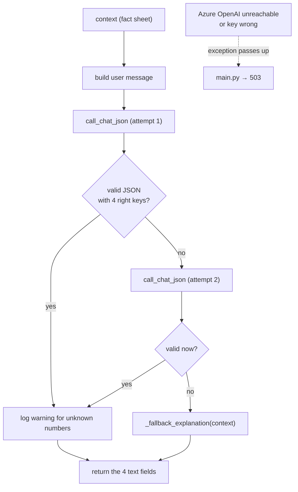
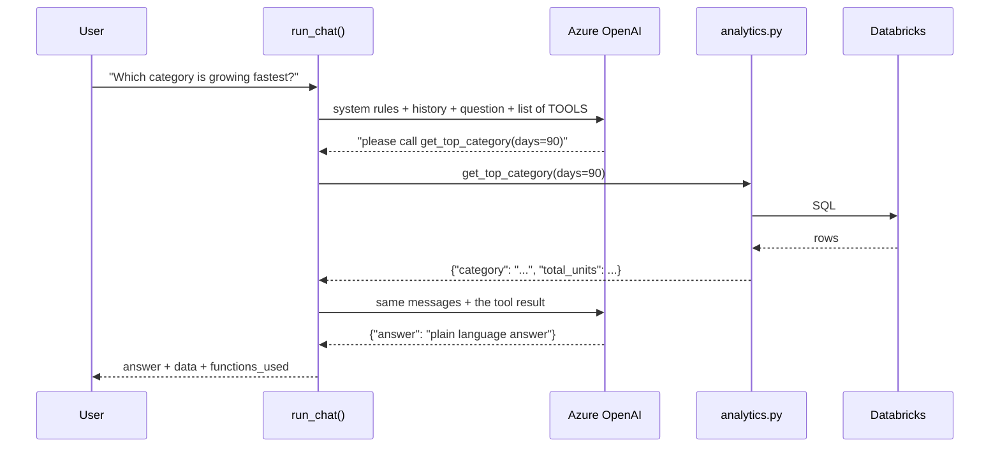

# Chapter 13: GenAI with Azure OpenAI

> 🎯 **What you will learn**
> - What an LLM is, and why we let it **explain** but never **calculate**
> - The "fact sheet" pattern: how the backend gives the AI only real numbers
> - How `/forecast/explain` works, step by step, with the code
> - How the chatbot uses **tool calling** (the AI asks, Python answers)
> - The safety layers around the AI, and which ones are strict and which only warn
> - How to test everything without spending money

⏱️ Time: about 90 minutes. No AI background needed.

---

## 🧸 The talented intern analogy

An LLM (Large Language Model) is like a **very well-read intern** who writes beautifully and *fast*, but sometimes states a wrong fact with great confidence.

You would not ask that intern to **calculate** next month's sales from memory. You would:

1. Put a **fact sheet** on the desk (real numbers, checked by your system).
2. Say: *"Using only this sheet, explain it to a manager. If the sheet does not say, say you do not know."*
3. **Check** what comes back.

That is this chapter. The ML model (Part 2) calculates. The LLM only **words** the result. This is the most important design rule of the project (see [Chapter 1](01-business-problem.md)).


---

## 🧠 Five words you need

| Word | Plain meaning |
|---|---|
| **LLM** | A program trained on lots of text that writes text. Here: a model hosted in **Azure OpenAI** |
| **Prompt** | The instructions and facts you send. Two parts: a **system** message (the rules) and a **user** message (the task) |
| **Deployment** | Your own named copy of a model inside Azure OpenAI. The code sends `model=<your deployment name>` |
| **JSON mode** | A setting that forces the reply to be valid JSON, so code can read it reliably |
| **Tool calling** | The AI may *ask* us to run a named function. We run it and hand the result back. The AI never touches the database |
| **Grounding** | Making sure the answer only uses real, given facts |

---

## 🗺️ The two AI features


| | **Explain** (`POST /forecast/explain`) | **Chat** (`POST /chat`) | **Quick buttons** (`POST /chat/quick`) |
|---|---|---|---|
| Who chooses the data? | Our code, always the same fact sheet | The AI chooses which tool to call | The button (our code) |
| Does it call the LLM? | Yes, once (twice on retry) | Yes, two or more calls | **No** |
| Where is the number from? | The fact sheet | Tool results | Analytics functions |
| Fast and always repeatable? | No | No | **Yes** |


> 💡 **A good design habit:** if a question can be a button, make it a button. It is faster, free and 100% repeatable. Save the AI for open questions.

---

## 🔌 Step 1: The client, `llm_client.py`

```python
load_dotenv(Path(__file__).resolve().parent.parent.parent / ".env")

AZURE_OPENAI_ENDPOINT = os.getenv("AZURE_OPENAI_ENDPOINT")
AZURE_OPENAI_API_KEY = os.getenv("AZURE_OPENAI_API_KEY")
AZURE_OPENAI_DEPLOYMENT_NAME = os.getenv("AZURE_OPENAI_DEPLOYMENT_NAME")
AZURE_OPENAI_API_VERSION = os.getenv("AZURE_OPENAI_API_VERSION", "2024-06-01")

_client = None


class LLMConfigError(RuntimeError):
    """Raised when required Azure OpenAI environment variables are missing."""


def get_client() -> AzureOpenAI:
    """Return a cached AzureOpenAI client, or raise LLMConfigError if unconfigured."""

    global _client

    if _client is None:
        required = {
            "AZURE_OPENAI_ENDPOINT": AZURE_OPENAI_ENDPOINT,
            "AZURE_OPENAI_API_KEY": AZURE_OPENAI_API_KEY,
            "AZURE_OPENAI_DEPLOYMENT_NAME": AZURE_OPENAI_DEPLOYMENT_NAME,
        }
        missing = [name for name, value in required.items() if not value]
        if missing:
            raise LLMConfigError(f"Missing Azure OpenAI environment variable(s): {', '.join(missing)}")

        _client = AzureOpenAI(
            azure_endpoint=AZURE_OPENAI_ENDPOINT,
            api_key=AZURE_OPENAI_API_KEY,
            api_version=AZURE_OPENAI_API_VERSION,
        )

    return _client


def call_chat_json(system_prompt: str, user_message: str) -> str:
    """Call the configured Azure OpenAI deployment in JSON mode.

    Returns the raw response content (a JSON string, per response_format).
    Raises LLMConfigError if credentials are missing; propagates the
    underlying openai SDK's exceptions on network/API failures so the caller
    can translate those into a clean HTTP error.
    """

    client = get_client()

    # No `temperature` override -- some deployments (e.g. reasoning-tier models)
    # only support the default value and reject any other.
    response = client.chat.completions.create(
        model=AZURE_OPENAI_DEPLOYMENT_NAME,
        response_format={"type": "json_object"},
        messages=[
            {"role": "system", "content": system_prompt},
            {"role": "user", "content": user_message},
        ],
    )

    return response.choices[0].message.content


def call_chat(
    messages: list[dict[str, Any]],
    tools: Optional[list[dict[str, Any]]] = None,
    json_mode: bool = False,
) -> ChatCompletionMessage:
    """General-purpose chat completion call, optionally with tool definitions
    and/or JSON-mode output. Used by the /chat tool-calling flow, where the
    caller needs the raw assistant message (to inspect .tool_calls), not
    just its .content -- unlike call_chat_json, which is JSON-mode only and
    used exclusively by /forecast/explain.

    Raises LLMConfigError if credentials are missing; propagates the
    underlying openai SDK's exceptions on network/API failures.
    """

    client = get_client()

    kwargs: dict[str, Any] = {"model": AZURE_OPENAI_DEPLOYMENT_NAME, "messages": messages}
    if tools:
        kwargs["tools"] = tools
        kwargs["tool_choice"] = "auto"
    if json_mode:
        kwargs["response_format"] = {"type": "json_object"}

    response = client.chat.completions.create(**kwargs)
    return response.choices[0].message
```

| Part | What it does |
|---|---|
| `load_dotenv(Path(__file__)...)` | Loads `backend/.env` **by path** (three folders up), so it works however you start the server |
| The four variables | Endpoint, key, **deployment name**, API version (default `2024-06-01`) |
| `LLMConfigError` | A special error meaning "a setting is missing". `main.py` turns it into **503** |
| `get_client()` | Checks the three required values, lists **all** the missing ones, and creates **one** shared client (cached in `_client`) |
| `call_chat_json()` | System + user message, JSON mode on. Returns the reply text. Used by *explain* |
| `call_chat()` | The general version: optional `tools` and optional `json_mode`. Returns the whole message so the caller can see `.tool_calls`. Used by *chat* |

Two details worth knowing:

- `model=AZURE_OPENAI_DEPLOYMENT_NAME`: in Azure you pass **your deployment's name**, not a brand name.
- There is no `temperature` setting on purpose. Some deployments (reasoning models) reject any value other than the default.

You can test the connection alone:

```bash
cd backend
python -m src.genai.llm_client --name Asha
```

You should see a short JSON greeting. If you see `Missing Azure OpenAI environment variable(s)`, fill in `.env`.

---

## 📋 Step 2: The fact sheet, `explain_context.py`

**No AI is called here.** This file turns database rows into a small, clean dictionary: *the only facts the AI may use*.

```python
def build_forecast_context(
    product_id: str,
    store_id: str,
    forecast_rows: list[dict[str, Any]],
    recent_features_rows: list[dict[str, Any]],
    product_static: Optional[dict[str, Any]],
) -> dict[str, Any]:
    """Assemble the structured, computed context dict handed to the LLM.

    forecast_rows: sales_ai.gold.forecast_results rows for this product/store
    (from db.fetch_forecasts). recent_features_rows: the last-N-days
    sales_ai.gold.sales_features rows (from db.fetch_recent_sales_features).
    product_static: sales_ai.silver.products attributes (from
    db.fetch_product_static), or None if the product isn't found there.
    """

    sorted_forecast = sorted(forecast_rows, key=lambda r: _to_date(r["forecast_date"]))
    predicted_units = [float(r["predicted_units"]) for r in sorted_forecast]
    avg_predicted = mean(predicted_units)
    total_predicted = sum(predicted_units)

    sorted_history = sorted(recent_features_rows, key=lambda r: _to_date(r["date"]))
    latest = sorted_history[-1]
    rolling_mean_28 = latest.get("rolling_mean_28")

    vs_recent_history_pct_change = None
    if rolling_mean_28:
        vs_recent_history_pct_change = round((avg_predicted - rolling_mean_28) / rolling_mean_28 * 100, 2)

    daily_forecast = [
        {"date": _to_date(r["forecast_date"]).isoformat(), "predicted_units": round(float(r["predicted_units"]), 2)}
        for r in sorted_forecast
    ]

    forecast_dates = [r["forecast_date"] for r in sorted_forecast]

    return {
        "product_id": product_id,
        "store_id": store_id,
        "category": (product_static or {}).get("category") or sorted_forecast[0].get("category"),
        "lifecycle_status": (product_static or {}).get("lifecycle_status"),
        "demand_class": (product_static or {}).get("demand_class"),
        "price_elasticity_tier": (product_static or {}).get("price_elasticity_tier"),
        "forecast_horizon_days": len(sorted_forecast),
        "forecast_start_date": _to_date(forecast_dates[0]).isoformat(),
        "forecast_end_date": _to_date(forecast_dates[-1]).isoformat(),
        "avg_predicted_units": round(avg_predicted, 2),
        "total_predicted_units": round(total_predicted, 2),
        "daily_forecast": daily_forecast,
        "model_version": sorted_forecast[-1].get("model_version"),
        "recent_actuals": {
            "window_days": len(sorted_history),
            "latest_date": _to_date(latest["date"]).isoformat(),
            "latest_units_sold": latest.get("units_sold"),
            "rolling_mean_28": rolling_mean_28,
            "trend_7d": latest.get("trend_7d"),
            "trend_28d": latest.get("trend_28d"),
            "yoy_growth_pct": latest.get("yoy_growth_pct"),
            "mom_growth_pct": latest.get("mom_growth_pct"),
        },
        "vs_recent_history_pct_change": vs_recent_history_pct_change,
        "promotion": {
            "promotion_flag": bool(latest.get("promotion_flag")),
            "days_since_last_promotion": latest.get("days_since_last_promotion"),
        },
        "holidays_in_forecast_window": _holidays_in_window(forecast_dates),
    }
```

**What goes on the fact sheet**

| Key | Source | Why |
|---|---|---|
| `avg_predicted_units`, `total_predicted_units`, `daily_forecast` | `forecast_results` | The numbers to explain |
| `forecast_start_date`, `forecast_end_date`, `forecast_horizon_days` | same | When |
| `model_version` | same | Traceability |
| `recent_actuals` (latest units, `rolling_mean_28`, `trend_7d`, `trend_28d`, `yoy_growth_pct`, `mom_growth_pct`) | `sales_features` | What recent history looked like |
| `vs_recent_history_pct_change` | **computed here** | `(avg forecast − rolling_mean_28) / rolling_mean_28 × 100` |
| `promotion` | `sales_features` | Was a promotion active? |
| `category`, `lifecycle_status`, `demand_class`, `price_elasticity_tier` | `silver.products` | What kind of product |
| `holidays_in_forecast_window` | a small dictionary in the file | Upcoming holidays |

A tiny worked example. Suppose the forecast averages **12.0** units a day and the 28-day rolling mean is **10.0**:

```text
(12.0 − 10.0) / 10.0 × 100 = +20.0 %
```

That `20.0` is calculated by **Python**. The AI will only *repeat* it in words.

> 📝 **Limitation:** `FIXED_FUTURE_HOLIDAYS` only lists two dates (1 Jan and 26 Jan 2026), matching the forecast window of this dataset. If your forecast moves into other months, extend that dictionary (or better, read holidays from a table).

---

## ✍️ Step 3: The prompt and the guardrails, `forecast_explainer.py`

### The system prompt (the rules)

```python
SYSTEM_PROMPT = """You are explaining a sales forecast that has ALREADY been generated by a machine learning model. You do not generate, change, or restate a different forecast number than the ones given to you in the context.

Only reference facts present in the JSON context provided in the user message. Do not invent statistics, dates, percentages, or numbers that are not present in that context.

If a user question is given and the context does not contain enough information to answer it, say so explicitly rather than guessing.

Respond with a single JSON object with exactly these keys and no others:
{
  "explanation": "string - plain language summary",
  "key_drivers": ["string", ...],
  "risks_or_opportunities": ["string", ...],
  "recommendation": "string"
}
Return nothing except this JSON object."""

REQUIRED_KEYS = {"explanation", "key_drivers", "risks_or_opportunities", "recommendation"}

_NUMBER_PATTERN = re.compile(r"-?\d+\.?\d*")

```

Read it as four rules: *do not change numbers*, *use only the context*, *say "not enough information" instead of guessing*, *reply as JSON with exactly these four keys*.

> ⚠️ **A prompt is a request, not a lock.** The AI usually obeys, but nothing *forces* it. That is why the code around it matters just as much.

### The user message (the task)

```python
def _build_user_message(context: dict[str, Any], user_question: Optional[str]) -> str:
    instruction = (
        f"Answer this specific question using only the context above: {user_question}"
        if user_question
        else "No specific question was asked -- produce a general explanation of this forecast."
    )
    return (
        "Context (the only facts you may reference):\n"
        f"{json.dumps(context, indent=2, default=str)}\n\n"
        f"{instruction}"
    )
```

The fact sheet is turned into text with `json.dumps(context, indent=2, default=str)`. `default=str` makes dates printable. If the user typed a question, it is added; otherwise the AI is asked for a general explanation.

### Check the reply: `_parse_and_validate`

```python
def _parse_and_validate(raw_content: str) -> Optional[dict[str, Any]]:
    try:
        parsed = json.loads(raw_content)
    except (json.JSONDecodeError, TypeError):
        return None

    if not isinstance(parsed, dict) or not REQUIRED_KEYS.issubset(parsed.keys()):
        return None
    if not isinstance(parsed["explanation"], str) or not isinstance(parsed["recommendation"], str):
        return None
    if not isinstance(parsed["key_drivers"], list) or not isinstance(parsed["risks_or_opportunities"], list):
        return None

    return {
        "explanation": parsed["explanation"],
        "key_drivers": [str(item) for item in parsed["key_drivers"]],
        "risks_or_opportunities": [str(item) for item in parsed["risks_or_opportunities"]],
        "recommendation": parsed["recommendation"],
    }
```

It returns `None` unless: the text is valid JSON, it is an object, it has **all four keys**, the two texts are strings and the two lists are lists. Items are forced to strings. This **strict shape check** means the frontend can trust the structure.

### The number check: `_check_numeric_grounding`

```python
def _check_numeric_grounding(explanation: str, context: dict[str, Any]) -> None:
    """Log a warning (never raises) if the explanation contains a number that
    doesn't appear anywhere in the context dict. Approximate on purpose --
    exact numeric matching (rounding, formatting) is hard to do perfectly."""

    context_numbers = set(_NUMBER_PATTERN.findall(json.dumps(context, default=str)))
    explanation_numbers = set(_NUMBER_PATTERN.findall(explanation))

    ungrounded = explanation_numbers - context_numbers
    if ungrounded:
        logger.warning("LLM explanation contains numbers not found in context: %s", sorted(ungrounded))
```

It finds every number in the explanation (a pattern `-?\d+\.?\d*`) and every number in the fact sheet, then logs a **warning** for any number that is not on the sheet.

> 🛑 **Important and honest:** this check **only logs**. It never blocks or changes the answer. It is "approximate on purpose": the AI may write `20%` when the sheet has `20.0`, or `1,234` when the sheet has `1234`. Treat the log as an early-warning light for developers. The *real* protection for the summary numbers is the next point.

### The numbers on screen do not come from the AI

Look again at the end of `explain_forecast` in `main.py` ([Chapter 12](12-backend-fastapi.md)):

```python
forecast_summary=ForecastSummary(
    avg_predicted_units=context["avg_predicted_units"],        # from the fact sheet
    total_predicted_units=context["total_predicted_units"],    # from the fact sheet
    vs_recent_history_pct_change=context["vs_recent_history_pct_change"],
),
explanation=narrative["explanation"],                          # from the AI
```

The three big numbers in the screen's cards are **copied from Python**. Only the sentences come from the AI.

### The safety net: `_fallback_explanation`

```python
def _fallback_explanation(context: dict[str, Any]) -> dict[str, Any]:
    """Generic templated explanation built purely from context, used when the
    LLM response can't be parsed/validated even after a retry -- the request
    must never fail just because the LLM misbehaved."""

    key_drivers = []
    if context["recent_actuals"].get("trend_28d") is not None:
        direction = "up" if context["recent_actuals"]["trend_28d"] >= 0 else "down"
        key_drivers.append(f"The 28-day sales trend is currently trending {direction}.")
    if context["promotion"]["promotion_flag"]:
        key_drivers.append("A promotion was active as of the most recent observed data.")
    if not key_drivers:
        key_drivers.append("Recent sales history and seasonality patterns.")

    risks = []
    if context["holidays_in_forecast_window"]:
        names = ", ".join(h["name"] for h in context["holidays_in_forecast_window"])
        risks.append(f"Holiday(s) fall within the forecast window ({names}), which may shift demand.")
    if not risks:
        risks.append("No specific risks identified from the available context.")

    change = context.get("vs_recent_history_pct_change")
    change_text = (
        f"{change:+.1f}% versus the trailing 28-day average"
        if change is not None
        else "an amount that couldn't be compared to recent history"
    )

    explanation = (
        f"Over the next {context['forecast_horizon_days']} days, the model predicts an average of "
        f"{context['avg_predicted_units']} units/day ({context['total_predicted_units']} total) for "
        f"product {context['product_id']} at store {context['store_id']}, {change_text}."
    )

    return {
        "explanation": explanation,
        "key_drivers": key_drivers,
        "risks_or_opportunities": risks,
        "recommendation": "Monitor actuals against this forecast and adjust inventory/staffing plans accordingly.",
    }
```

If the AI misbehaves twice, the user still gets a **sensible, plain answer built from the fact sheet**: trend direction, promotion, holidays, and the forecast average. The request does not fail just because the AI was moody.

### The loop that ties it together: `generate_explanation`

```python
def generate_explanation(context: dict[str, Any], user_question: Optional[str]) -> dict[str, Any]:
    """Run Steps 2-4: build the prompt, call the LLM, validate/repair its
    response, and return the four narrative fields (explanation, key_drivers,
    risks_or_opportunities, recommendation).

    Never raises for a malformed LLM response -- falls back to a templated
    explanation instead. Network/credential failures from the LLM call
    itself DO propagate, so the caller can turn them into a clean 503.
    """

    user_message = _build_user_message(context, user_question)

    for attempt in range(2):
        raw_content = call_chat_json(SYSTEM_PROMPT, user_message)
        parsed = _parse_and_validate(raw_content)
        if parsed is not None:
            _check_numeric_grounding(parsed["explanation"], context)
            return parsed
        logger.warning("LLM response failed validation on attempt %d: %r", attempt + 1, raw_content)

    logger.warning("LLM response failed validation twice; falling back to templated explanation.")
    return _fallback_explanation(context)
```



Notice the two kinds of failure are treated differently:

- **The AI answered badly** → retry once, then use the template. The user never sees a failure.
- **We cannot reach the AI at all** → the error passes up and `main.py` returns **503** with a clear message.

---

## 🛡️ The seven layers around the AI


Green layers are **enforced by code**. Amber layers only **advise or warn**. Knowing the difference is what separates a demo from a dependable system.

---

## 💬 Step 4: The chatbot, `chatbot.py`

### The idea: the AI asks, Python answers



The AI never sees the database and never runs SQL. It sees a **menu of six tools**, each with a name, a description and parameters.


### The rules, and the store hint

```python
SYSTEM_PROMPT = """You are a retail sales analytics assistant for a sales forecasting dashboard.

Answer questions using ONLY the tools provided -- call a tool to fetch real
data, then narrate exactly what the tool(s) returned. Never invent numbers,
product names, categories, or store names that are not present in a tool
result. If no tool fits the question, or a tool didn't return enough
information to answer, say so rather than guessing.

If the user asks to compare two categories but only names one (or none),
ask them to clarify instead of guessing at the second category.

Once you have the data you need, respond with a single JSON object of this
exact shape and nothing else:
{"answer": "plain language answer, may use simple markdown"}"""


def _build_system_prompt(store_id: Optional[str], store_name: Optional[str]) -> str:
    if not store_id:
        return SYSTEM_PROMPT

    label = store_name or store_id
    return (
        f"{SYSTEM_PROMPT}\n\n"
        f"The user currently has store {store_id} ({label}) selected on the dashboard. "
        f'When calling get_top_category or get_top_product, pass store_id="{store_id}" unless '
        f"the question explicitly asks about all stores or names a different store."
    )
```

If the user picked a store in the screen, `_build_system_prompt` adds one sentence: *"the user has store S01 selected, pass it to the store-scoped tools unless they ask otherwise."* Without this, "top category?" would always answer for all stores.

### The tool menu

Each entry in `TOOLS` is a description in a standard format (JSON Schema). Here is one:

```python
    {
        "type": "function",
        "function": {
            "name": "compare_categories",
            "description": "Compare total and average daily actual units sold between two product categories.",
            "parameters": {
                "type": "object",
                "properties": {
                    "category_a": {"type": "string", "description": "First category name"},
                    "category_b": {"type": "string", "description": "Second category name"},
                    "days": {"type": "integer", "description": "Lookback window in days (default 90)"},
                },
                "required": ["category_a", "category_b"],
            },
        },
    },
```

| Tool | Answers | Required parameters |
|---|---|---|
| `get_top_category` | Best-selling category | none |
| `get_top_product` | Best-selling product | none |
| `compare_categories` | Two categories head to head | `category_a`, `category_b` |
| `get_store_performance` | A store now vs its own baseline | `store_id` |
| `get_trending_down` | Products or stores trending down | `level` |
| `get_predicted_revenue_summary` | Total predicted units and revenue | none |

The **descriptions are part of the prompt**. Good descriptions are how the AI picks the right tool, so write them like instructions to a new colleague.

### The dispatch table

```python
TOOL_DISPATCH = {
    "get_top_category": lambda args: analytics.get_top_category(
        days=args.get("days") or 90, store_id=args.get("store_id")
    ),
    "get_top_product": lambda args: analytics.get_top_product(
        days=args.get("days") or 90, store_id=args.get("store_id")
    ),
    "compare_categories": lambda args: analytics.compare_categories(
        args["category_a"], args["category_b"], days=args.get("days") or 90
    ),
    "get_store_performance": lambda args: analytics.get_store_performance(
        args["store_id"],
        recent_days=args.get("recent_days") or 30,
        baseline_days=args.get("baseline_days") or 180,
    ),
    "get_trending_down": lambda args: analytics.get_trending_down(
        args["level"],
        threshold_pct=args["threshold_pct"] if args.get("threshold_pct") is not None else -10.0,
    ),
    "get_predicted_revenue_summary": lambda args: analytics.get_predicted_revenue_summary(),
}
```

`TOOL_DISPATCH` maps a **tool name** to a Python function. The AI says a name; we look it up here. Anything not in this table cannot run. That is a security feature: **the AI can only trigger functions we deliberately listed.** The `args.get("days") or 90` pattern supplies defaults.

### Running the tools safely

```python
def _execute_tool_calls(tool_calls) -> dict[str, Any]:
    """Run each tool the model requested, returning {tool_name: result}."""

    results: dict[str, Any] = {}
    for call in tool_calls:
        name = call.function.name
        try:
            args = json.loads(call.function.arguments or "{}")
        except json.JSONDecodeError:
            args = {}

        handler = TOOL_DISPATCH.get(name)
        if handler is None:
            results[name] = {"error": f"Unknown tool: {name}"}
            continue

        try:
            results[name] = handler(args)
        except Exception:
            logger.exception("Analytics function %s failed for args=%s", name, args)
            results[name] = {"error": f"{name} failed to run."}

    return results
```

- Bad JSON in the arguments becomes `{}` (no crash).
- An unknown tool name returns an error entry.
- A tool that fails is logged, and the AI is told only `"<name> failed to run."`. No stack trace goes to the model or the user.

### The main function, `run_chat`

```python
def run_chat(
    message: str,
    history: Optional[list[dict[str, str]]] = None,
    store_id: Optional[str] = None,
    store_name: Optional[str] = None,
) -> dict[str, Any]:
    """Answer a free-text question via LLM tool-calling.

    store_id/store_name, when given (the dashboard's currently-selected
    store), are added to the system prompt as context so store-scoped tools
    apply that filter by default -- without this, get_top_category/
    get_top_product always answer globally regardless of what's selected.

    Returns {"answer": str, "data": dict, "functions_used": list[str]}.
    Never raises for a malformed final answer -- falls back to a templated
    one built from the actual tool results instead. Network/credential
    failures from the LLM call itself DO propagate, so the caller can turn
    them into a clean 503 (same contract as
    forecast_explainer.generate_explanation).
    """

    messages: list[dict[str, Any]] = [{"role": "system", "content": _build_system_prompt(store_id, store_name)}]
    for turn in history or []:
        if turn.get("role") in ("user", "assistant") and turn.get("content"):
            messages.append({"role": turn["role"], "content": turn["content"]})
    messages.append({"role": "user", "content": message})

    assistant_message = call_chat(messages, tools=TOOLS)
    tool_results: dict[str, Any] = {}

    if assistant_message.tool_calls:
        messages.append(assistant_message.model_dump(exclude_none=True))
        tool_results = _execute_tool_calls(assistant_message.tool_calls)
        for call in assistant_message.tool_calls:
            messages.append(
                {
                    "role": "tool",
                    "tool_call_id": call.id,
                    "content": json.dumps(tool_results.get(call.function.name, {}), default=str),
                }
            )

    for attempt in range(2):
        final_message = call_chat(messages, json_mode=True)
        answer = _parse_answer(final_message.content)
        if answer is not None:
            if tool_results:
                _check_numeric_grounding(answer, tool_results)
            return {"answer": answer, "data": tool_results, "functions_used": list(tool_results.keys())}
        logger.warning("Chat final answer failed validation on attempt %d: %r", attempt + 1, final_message.content)

    logger.warning("Chat final answer failed validation twice; falling back to templated answer.")
    return {
        "answer": _fallback_answer(tool_results),
        "data": tool_results,
        "functions_used": list(tool_results.keys()),
    }
```

Walk through it:

1. Build the messages: system prompt, earlier turns (only `user`/`assistant` text), the new question.
2. **First call** to the AI, with the tools available.
3. If it asked for tools: add its request to the conversation, run the tools, add each result as a `tool` message.
4. **Final call** in JSON mode, asking for `{"answer": "..."}`. Up to **two attempts**.
5. If valid, optionally log unknown numbers (`_check_numeric_grounding`, which, like Step 3, **only warns**), and return `{answer, data, functions_used}`.
6. If both attempts fail, `_fallback_answer` builds a plain answer straight from the tool results.

The response carries `data` (the raw tool results) and `functions_used`, so a screen can show **which analytics functions produced the numbers**. The Streamlit app prints this as *"Data tools used: ..."*.

### Quick actions (no AI)

```python
QUICK_ACTIONS: dict[str, tuple] = {
    "top_category": (
        lambda params: analytics.get_top_category(store_id=params.get("store_id")),
        _format_top_category,
    ),
    "top_product": (
        lambda params: analytics.get_top_product(store_id=params.get("store_id")),
        _format_top_product,
    ),
    "compare_categories": (
        lambda params: analytics.compare_categories(params["category_a"], params["category_b"]),
        _format_compare_categories,
    ),
    "store_performance": (
        lambda params: analytics.get_store_performance(params["store_id"]),
        _format_store_performance,
    ),
    "underperforming_stores": (lambda params: analytics.get_trending_down("store"), _format_trending_down),
    "trending_down_products": (lambda params: analytics.get_trending_down("product"), _format_trending_down),
    "predicted_revenue": (lambda params: analytics.get_predicted_revenue_summary(), _format_predicted_revenue),
}


def run_quick_action(action: str, params: Optional[dict[str, Any]] = None) -> dict[str, Any]:
    """Deterministic (no-LLM) answer for one of the predefined quick-question
    buttons -- calls the same analytics.py functions as run_chat's tools,
    just without an LLM deciding which one to call.

    Raises KeyError if a required param is missing, ValueError if the action
    is unknown -- both are caller errors (400), not server errors.
    """

    entry = QUICK_ACTIONS.get(action)
    if entry is None:
        raise ValueError(f"Unknown quick action: {action}")

    fetch, formatter = entry
    result = fetch(params or {})
    return {"answer": formatter(result), "data": {action: result}, "functions_used": [action]}
```

`QUICK_ACTIONS` pairs each button name with (a function that fetches data, a function that writes the sentence). The sentences are **templates**, for example:

```python
def _format_top_category(result: dict[str, Any]) -> str:
    if result["category"] is None:
        return "No sales data is available for that window."
    return (
        f"**{result['category']}** is the top-selling category{_scope_phrase(result)} over the last "
        f"{result['days']} days, with {result['total_units']:,.0f} units sold."
    )
```

`{result['total_units']:,.0f}` formats `85438.0` as `85,438`. The words are fixed; only the numbers change, so two people always get identical answers.

---

## 🧪 Try it

### Without Azure (free)

1. Start the mock backend: `python tools/mock_backend.py`.
2. In `/docs`, run `POST /chat/quick` with `{"action": "top_category", "params": {}}`. Real answer from the CSVs, no AI.
3. Run `POST /forecast/explain`. The mock returns clearly labelled **demo** text so the screens can be developed and tested.

### With Azure OpenAI

1. Fill the four variables in `backend/.env` ([Chapter 3](03-setup-and-costs.md)).
2. Run the real backend after the Databricks job has produced the Gold tables.
3. In `/docs`, call `POST /forecast/explain`:

```json
{"product_id": "P001", "store_id": "S01", "user_question": "Why is next week higher than this week?"}
```

4. Look at the **server log** (the terminal running the backend). Warnings like `LLM explanation contains numbers not found in context` tell you the AI used a number that was not on the fact sheet.

✅ **Checkpoint:** ask the same question with `user_question: null` and then with a question. The four number cards stay identical; only the words change. That proves the numbers do not come from the AI.

### Break it on purpose (learning exercise)

1. Remove `AZURE_OPENAI_API_KEY` from `.env`, restart, call `/forecast/explain`. You get `503` and a message naming the missing variable.
2. Ask the chatbot: *"What is the weather in Paris?"* A good answer says no tool fits, instead of guessing.
3. Ask: *"Compare Electronics"* (only one category). The system prompt tells the AI to ask which second category you mean.

---

## 💰 Cost and speed

- You pay per **token** (roughly, per word piece sent and received). The fact sheet is small (a few thousand characters), not raw tables.
- Explain makes **1 call** normally. Chat makes **2** when it uses a tool, and more only if the reply has to be retried.
- Quick buttons make **0** calls.
- Use prices from the [official pricing page](https://azure.microsoft.com/pricing/details/cognitive-services/openai-service/), never from memory.

---

## 🛠️ Common problems

| Symptom | Cause | Fix |
|---|---|---|
| 503 *GenAI explanation service is not configured: Missing ... AZURE_OPENAI_...* | Empty variable | Fill all of endpoint, key, deployment name |
| 503 *currently unreachable* | Wrong endpoint, wrong deployment name, no network, quota | Check the deployment name matches the one in Azure; check the log for the real error |
| Log: `response failed validation` | AI sent bad or incomplete JSON | The code retries, then falls back. If frequent, shorten the question or try another deployment |
| Log: `numbers not found in context` | AI rounded or reformatted a number, or invented one | Compare with the fact sheet. Tighten the prompt |
| Chat answer is "Here's the data I found: ..." | Both final attempts failed validation | Fallback was used. Check the log |
| Answers ignore the selected store | Store not sent | The screen must send `store_id` and `store_name` with `/chat` |

---

## 🔎 Things to know (honest notes)

- **The number check only warns.** It does not stop a wrong number from being shown. The summary cards are safe because they come from Python; the *sentences* are trusted but logged.
- **One round of tools.** `run_chat` makes a single tool round. If a question needs data from a second step, the AI cannot continue chaining.
- **Same tool twice.** Results are stored by tool **name**. If the AI calls the same tool twice in one turn (for example two different stores), the later result overwrites the earlier one, and both `tool` messages receive that last result. Prefer one call per tool, or key results by call id (a good first improvement).
- **First reply is discarded when no tool is used.** If the AI answers directly without a tool, that text is thrown away, and a second call (JSON mode) produces the final answer. It works, but costs an extra call.
- **Holiday list is short.** See the note in Step 2.
- **No streaming.** The answer arrives all at once, which is why the screens show a spinner.
- **History grows.** The frontends send all earlier turns; a long chat means more tokens. Trimming old turns is a simple saving.
- **Not a lawyer or accountant.** The recommendation text is decision support for a human planner.

---

## ✅ Checkpoint

1. Why do we give the AI a fact sheet instead of the raw tables?
2. Which three numbers on the explain screen never come from the AI?
3. What happens when the AI returns broken JSON twice?
4. Why can the AI not run `DROP TABLE`?
5. Name one *advisory* layer and one *enforced* layer from the diagram.

---

## 🔗 Learn more

- [Azure OpenAI overview](https://learn.microsoft.com/azure/ai-services/openai/overview)
- [Azure OpenAI function (tool) calling](https://learn.microsoft.com/azure/ai-services/openai/how-to/function-calling)
- [Azure OpenAI JSON mode](https://learn.microsoft.com/azure/ai-services/openai/how-to/json-mode)
- [OpenAI Python library](https://github.com/openai/openai-python)
- [Prompt engineering basics (Microsoft Learn)](https://learn.microsoft.com/azure/ai-services/openai/concepts/prompt-engineering)
- [Responsible AI practices (Microsoft)](https://www.microsoft.com/ai/responsible-ai)

⬅️ [Chapter 12](12-backend-fastapi.md) · ➡️ **Next:** [Chapter 14: Frontend A, React](14-frontend-react.md)
