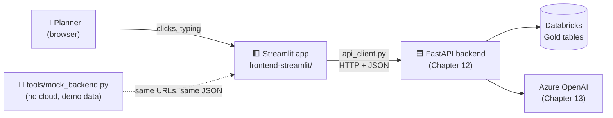
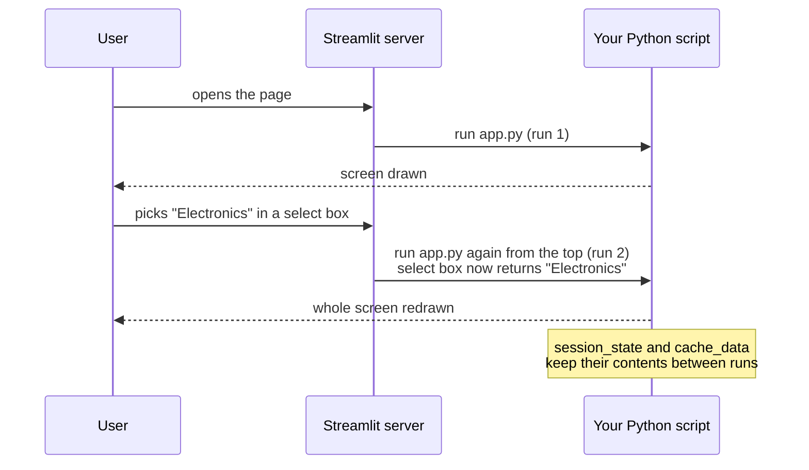
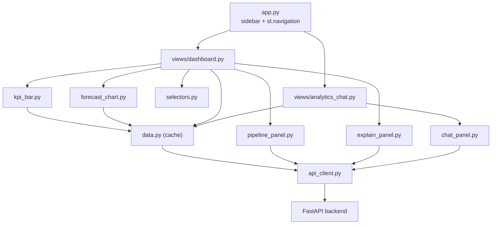
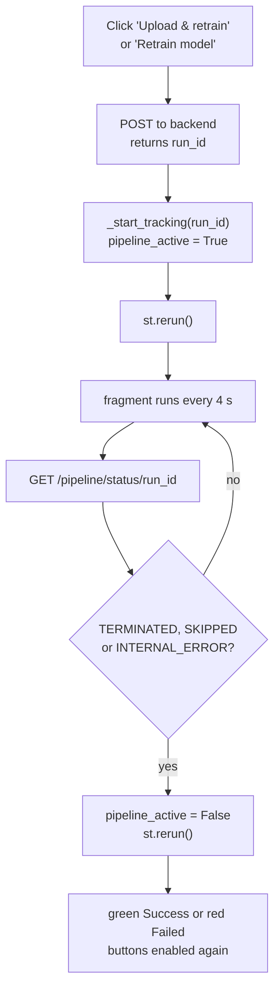

# Chapter 15: Frontend B, Streamlit

> 🎯 **What you will learn**
> - How Streamlit thinks (it re-runs your script on every click, and why that is fine)
> - How to build the whole Sales AI screen in **pure Python**, one small step at a time
> - How to run it **with no cloud account** using the mock backend
> - How to test it without a browser, and how to put it in Docker

⏱️ Time: about 2 hours if you type the code yourself, 15 minutes if you only run it.

> 💡 **You only know Python? This is your chapter.** Streamlit needs no HTML, CSS or JavaScript. Everything in [Chapter 14](14-frontend-react.md) (React) is done here with plain Python functions.

---

## 🧸 The whiteboard analogy

Imagine a **whiteboard** that a helper redraws from scratch every time you ask for something.

- You say "show Electronics". The helper wipes the board and draws the whole board again, this time with Electronics.
- The helper has a **notebook** (`session_state`) for things that must survive the wipe, and a **memory shelf** (`cache_data`) for answers that took a long time to get.

That is Streamlit. Your Python file is the helper's instructions. Streamlit **runs the whole file, top to bottom, every time the user does anything**. It sounds wasteful, but it makes programs very simple to reason about: *the screen is always a direct result of your code and your notebook*.

---

## 🗺️ Where Streamlit fits



The Streamlit app is **only a screen**. It never touches Databricks or Azure OpenAI. It talks to the backend, exactly like the React app. That is why you can swap the real backend for the mock one without changing a line of the screen.

---

## ▶️ Try it first: run it in 3 minutes (no cloud needed)

You need Python 3.12 or newer. Open **two** terminals in the repository folder.

**Terminal 1: the mock backend** (fake backend that reads the real CSVs in `data/`)

```bash
pip install fastapi uvicorn pandas python-multipart
python tools/mock_backend.py
```

Wait for the line `Uvicorn running on http://127.0.0.1:8000`. Loading the CSVs takes a few seconds.

**Terminal 2: the Streamlit app**

```bash
cd frontend-streamlit
python -m venv .venv
source .venv/bin/activate          # Windows PowerShell: .venv\Scripts\Activate.ps1
pip install -r requirements.txt
streamlit run app.py
```

Your browser opens **<http://localhost:8501>**.


> 🧪 **The mock is clearly labelled.** The sidebar shows a yellow *"Mock backend: demo data only, not the real ML model"* box, and the forecast is just a weekday average. It exists so you can learn the screen before you build Databricks. To use your real backend, start it from [Chapter 3](03-setup-and-costs.md) instead; nothing else changes.

---

## 🧠 The 6 Streamlit ideas you need

| Idea | Plain meaning | Used in this app for |
|---|---|---|
| **Rerun model** | The script runs top to bottom on every interaction | Everything |
| **Widget** | A function that draws a control *and returns its value* (`st.button` returns `True` on the click that caused this run) | Select boxes, buttons, uploader |
| **`st.session_state`** | A dictionary that survives reruns | Remembering the explanation, chat history, pipeline run |
| **`st.cache_data`** | Remembers a function's answer for a while | Not calling the backend on every click |
| **Layout** | `st.columns`, `st.container`, `st.expander`, `st.sidebar` | Cards, side by side panels |
| **Fragment** | Part of the page that can refresh by itself | The live "training run" status box |



---

## 📁 The project map

```text
frontend-streamlit/
├── app.py                  ← entry point: page setup, sidebar, navigation
├── api_client.py           ← the ONLY file that talks HTTP
├── components/
│   ├── data.py             ← cached loaders
│   ├── kpi_bar.py          ← 4 KPI cards
│   ├── selectors.py        ← product and store drop-downs
│   ├── forecast_chart.py   ← actual vs forecast chart
│   ├── explain_panel.py    ← "Explain this forecast"
│   ├── pipeline_panel.py   ← upload CSV and retrain, live status
│   └── chat_panel.py       ← quick questions and free chat
├── views/
│   ├── dashboard.py        ← page 1
│   └── analytics_chat.py   ← page 2
├── tests/test_app.py       ← 11 automatic tests
├── .streamlit/config.toml  ← colours and settings
├── requirements.txt
├── .env.example
└── Dockerfile
```



> 🧱 **Design rule:** *screens never build URLs.* They call a Python function (`get_kpis()`), and `api_client.py` deals with the network. If the backend address changes, you edit one file.

---

## 🛠️ Build it, step by step

Each step adds one file. After each one there is a **checkpoint** so you know it works before moving on. The code below is copied from the real files in the repository, so you can also just open them.

### Step 1: Create the folder and install

```bash
mkdir frontend-streamlit && cd frontend-streamlit
python -m venv .venv
source .venv/bin/activate          # Windows: .venv\Scripts\Activate.ps1
mkdir components views tests .streamlit
```

Create `requirements.txt`:

```text
# Tested with Streamlit 1.66 and Python 3.13. Older Streamlit versions may not
# support `width="stretch"`, `st.navigation` or `st.fragment(run_every=...)`.
streamlit>=1.66
plotly>=6.0
requests>=2.32
python-dotenv>=1.0
```

| Package | Why |
|---|---|
| `streamlit` | The framework. Version 1.66 or newer is needed for `st.navigation`, `st.fragment(run_every=...)` and `width="stretch"` |
| `plotly` | Interactive charts |
| `requests` | Calls the backend |
| `python-dotenv` | Reads a `.env` file |

```bash
pip install -r requirements.txt
```

Create `.env.example` (and copy it to `.env`):

```text
# Where is the Sales AI backend (FastAPI) running?
# Local real backend or the no-cloud mock backend:  http://localhost:8000
# Deployed backend: https://<your-backend>.azurecontainerapps.io
SALES_AI_API_URL=http://localhost:8000
```

✅ **Checkpoint:** `streamlit hello` opens a demo page. Press `Ctrl+C` to stop it.

---

### Step 2: Feel the rerun model

Before the real app, a 6-line experiment. Create `scratch.py`:

```python
import streamlit as st

st.title("Rerun demo")
if "clicks" not in st.session_state:
    st.session_state["clicks"] = 0

if st.button("Click me"):
    st.session_state["clicks"] += 1

st.write("Clicks so far:", st.session_state["clicks"])
```

Run `streamlit run scratch.py` and click the button three times.

- The counter reaches 3 because `session_state` survives reruns.
- Replace `st.session_state["clicks"]` with a plain variable `clicks = 0` and it would **always show 0 or 1**, because the script starts from zero on every run.

> 🧠 **If you remember one thing:** anything that must survive a click goes in `st.session_state`. Anything slow that does not change goes in `st.cache_data`.

Delete `scratch.py` when you are done.

---

### Step 3: `api_client.py`, the only file that talks to the backend

```python
"""All HTTP calls to the Sales AI backend live in this one file.

Why one file?
    The screens (views/ and components/) should never build URLs or handle
    network errors themselves. They call a plain Python function such as
    ``get_kpis()`` and either get data back or get an ``ApiError`` with a
    friendly message they can show to the user.

The backend address comes from the SALES_AI_API_URL environment variable
(default: http://localhost:8000), so the same code works on your laptop,
in Docker and in the cloud.
"""

import os
from typing import Any, Optional

import requests
from dotenv import load_dotenv

load_dotenv()  # reads frontend-streamlit/.env if it exists

API_URL = os.getenv("SALES_AI_API_URL", "http://localhost:8000").rstrip("/")

# Seconds to wait for each kind of call. The slow ones (explain, chat, pipeline)
# talk to Databricks and/or the LLM, so they get more time. These are the same
# numbers the React app uses.
TIMEOUT_DEFAULT = 10
TIMEOUT_LISTS = 20      # /products, /stores
TIMEOUT_KPIS = 30
TIMEOUT_SLOW = 60       # /forecast/explain, /chat, /chat/quick, /pipeline/*
TIMEOUT_STATUS = 20


class ApiError(Exception):
    """A problem calling the backend, with a message safe to show to a user."""


def _request(method: str, path: str, *, timeout: int = TIMEOUT_DEFAULT, **kwargs: Any) -> Any:
    """Send one HTTP request and return the decoded JSON.

    Every failure is converted into an ApiError so the screens only need one
    ``except ApiError`` block.
    """
    url = f"{API_URL}{path}"
    try:
        response = requests.request(method, url, timeout=timeout, **kwargs)
    except requests.exceptions.ConnectionError:
        raise ApiError(
            f"Cannot reach the backend at {API_URL}. "
            "Is it running? (Start the real backend or `python tools/mock_backend.py`.)"
        ) from None
    except requests.exceptions.Timeout:
        raise ApiError("The backend took too long to answer. Please try again.") from None

    if response.status_code >= 400:
        # FastAPI puts its human-readable error text in {"detail": "..."}
        try:
            detail = response.json().get("detail")
        except ValueError:
            detail = None
        if isinstance(detail, str):
            raise ApiError(detail)
        raise ApiError(f"Request failed ({response.status_code}).")

    return response.json()


# ----- Health ---------------------------------------------------------------

def get_health() -> dict:
    return _request("GET", "/health", timeout=TIMEOUT_LISTS)


# ----- Lists for the drop-downs ----------------------------------------------

def get_products() -> list[dict]:
    return _request("GET", "/products", timeout=TIMEOUT_LISTS)


def get_stores() -> list[dict]:
    return _request("GET", "/stores", timeout=TIMEOUT_LISTS)


# ----- Forecast --------------------------------------------------------------

def get_forecast(product_id: str, store_id: str, history_days: int = 90) -> dict:
    """Past actual sales + the next 30 days of forecast on one timeline."""
    return _request(
        "GET",
        "/forecast",
        params={
            "product_id": product_id,
            "store_id": store_id,
            "include_history": "true",
            "history_days": history_days,
        },
    )


def explain_forecast(product_id: str, store_id: str, user_question: Optional[str] = None) -> dict:
    return _request(
        "POST",
        "/forecast/explain",
        json={"product_id": product_id, "store_id": store_id, "user_question": user_question},
        timeout=TIMEOUT_SLOW,
    )


# ----- KPIs and chat ---------------------------------------------------------

def get_kpis() -> dict:
    return _request("GET", "/kpis", timeout=TIMEOUT_KPIS)


def send_chat(
    message: str,
    history: list[dict],
    store_id: Optional[str] = None,
    store_name: Optional[str] = None,
) -> dict:
    return _request(
        "POST",
        "/chat",
        json={
            "message": message,
            "history": history,
            "store_id": store_id or None,
            "store_name": store_name or None,
        },
        timeout=TIMEOUT_SLOW,
    )


def send_quick_action(action: str, params: Optional[dict] = None) -> dict:
    return _request(
        "POST",
        "/chat/quick",
        json={"action": action, "params": params or {}},
        timeout=TIMEOUT_SLOW,
    )


# ----- Pipeline (retrain) ----------------------------------------------------

def trigger_pipeline() -> dict:
    return _request("POST", "/pipeline/trigger", timeout=TIMEOUT_SLOW)


def upload_and_trigger(files: list[tuple[str, bytes]]) -> dict:
    """Upload CSV files and start the pipeline in one call.

    ``files`` is a list of (filename, file_bytes) pairs.

    The backend does NOT take a generic list of files. It has two named form
    fields, so we pick the field from the start of the file name:
        calendar_marketing_external*.csv  -> field "calendar_marketing_file"
        sales_transactions*.csv           -> field "sales_transactions_file"
    (At most one file per field.)
    """
    multipart = []
    for name, content in files:
        field = (
            "calendar_marketing_file"
            if name.startswith("calendar_marketing_external")
            else "sales_transactions_file"
        )
        multipart.append((field, (name, content, "text/csv")))
    return _request("POST", "/pipeline/upload-and-trigger", files=multipart, timeout=TIMEOUT_SLOW)


def get_pipeline_status(run_id: int) -> dict:
    return _request("GET", f"/pipeline/status/{run_id}", timeout=TIMEOUT_STATUS)
```

**Function by function**

| Part | What it does | Why it matters |
|---|---|---|
| `load_dotenv()` and `API_URL` | Reads `SALES_AI_API_URL` (default `http://localhost:8000`) | The same code works on your laptop, in Docker and in the cloud. `.rstrip("/")` avoids a double slash |
| `TIMEOUT_*` constants | How many seconds to wait for each kind of call | Slow calls (AI, pipeline) get 60 s. The same numbers as the React app |
| `ApiError` | Our own error type | Screens catch **one** kind of error and show its message |
| `_request()` | Sends the call and returns decoded JSON | Turns *connection refused*, *timeout* and *HTTP 4xx/5xx* into a friendly `ApiError`. FastAPI's `{"detail": "..."}` text is passed through |
| `get_health`, `get_products`, `get_stores`, `get_kpis` | One line each | Thin wrappers: name = purpose |
| `get_forecast()` | `GET /forecast` with `include_history=true` | One timeline: past actuals plus 30-day forecast |
| `explain_forecast()` | `POST /forecast/explain` | Accepts an optional `user_question` (the React app does not use it, Streamlit does) |
| `send_chat()` / `send_quick_action()` | `POST /chat` and `POST /chat/quick` | `or None` turns empty strings into JSON `null` |
| `upload_and_trigger()` | Multipart upload | Picks the **form field name** from the file name, see the box below |
| `get_pipeline_status()` | `GET /pipeline/status/{run_id}` | Polled while a run is active |

> ⚠️ **A real bug we found while writing this chapter.** The backend does **not** accept a generic list of files. It has two *named* form fields: `sales_transactions_file` and `calendar_marketing_file` (see [Chapter 12](12-backend-fastapi.md)). The original React code sent a field called `files`, and the real backend answered *"No files provided."* Both frontends now choose the field from the file name. If you build your own client, remember: **the field name is part of the contract.**

✅ **Checkpoint:** in a Python shell, with the mock backend running:

```python
>>> import api_client
>>> api_client.get_health()
{'status': '... MOCK MODE ...', 'databricks_connected': False}
>>> api_client.get_products()[0]
```

If the backend is not running you should see `ApiError: Cannot reach the backend at http://localhost:8000...`. That message is the feature working.

---

### Step 4: `components/data.py`, cached loaders

```python
"""Cached data loaders.

Streamlit re-runs your whole script on every click. Without caching, every
click would call the backend (and Databricks behind it) again. ``st.cache_data``
remembers the answer for ``ttl`` seconds, so the app stays fast and cheap.

Errors are NOT cached: if the backend is down, the next run simply tries again.
"""

import streamlit as st

import api_client


@st.cache_data(ttl=300, show_spinner=False)
def load_products() -> list[dict]:
    return api_client.get_products()


@st.cache_data(ttl=300, show_spinner=False)
def load_stores() -> list[dict]:
    return api_client.get_stores()


@st.cache_data(ttl=120, show_spinner=False)
def load_kpis() -> dict:
    return api_client.get_kpis()


@st.cache_data(ttl=120, show_spinner=False)
def load_forecast(product_id: str, store_id: str, history_days: int = 90) -> dict:
    # product_id and store_id are part of the cache key, so each combination
    # is cached separately.
    return api_client.get_forecast(product_id, store_id, history_days)
```

- `@st.cache_data(ttl=300)` means: "remember the result for **300 seconds**, then ask again".
- `product_id` and `store_id` are part of the **cache key**, so each combination has its own saved answer.
- If the function raises an error, Streamlit does **not** cache it. Next run, it tries again.
- `show_spinner=False` hides the default spinner; the screens show their own messages.

| Loader | Time to live | Why |
|---|---|---|
| `load_products`, `load_stores` | 5 min | Lists almost never change |
| `load_kpis` | 2 min | Five queries on the backend, so avoid repeating them |
| `load_forecast` | 2 min | One saved answer per product and store |

---

### Step 5: `app.py`, page setup, sidebar and navigation

```python
"""Sales AI: Streamlit frontend (entry point).

Run it with:   streamlit run app.py

Streamlit re-runs this file from top to bottom every time the user does
something. So this file only does the things every page needs (page setup,
sidebar, navigation) and then hands over to the page the user chose.
"""

import streamlit as st

import api_client

st.set_page_config(page_title="Sales AI", page_icon="📈", layout="wide")


@st.cache_data(ttl=30, show_spinner=False)
def check_backend() -> tuple[bool, str]:
    """Ask GET /health whether the backend is alive. Cached for 30 seconds."""
    try:
        return True, api_client.get_health().get("status", "")
    except api_client.ApiError as error:
        return False, str(error)


# ---- Sidebar: which backend am I talking to, and is it healthy? -----------
with st.sidebar:
    st.markdown("### Sales AI")
    alive, status_text = check_backend()
    st.caption(f"Backend: `{api_client.API_URL}`")
    if not alive:
        st.error(status_text)
    elif "MOCK" in status_text.upper():
        st.warning("Mock backend: demo data only, not the real ML model.")
    else:
        st.success("Backend connected")

# ---- Navigation: two pages -----------------------------------------------
pages = st.navigation([
    st.Page("views/dashboard.py", title="Dashboard", icon="📈", default=True),
    st.Page("views/analytics_chat.py", title="Analytics Chat", icon="💬"),
])
pages.run()
```

| Lines | What happens |
|---|---|
| `st.set_page_config(...)` | **Must be the first Streamlit call.** Sets tab title, icon and wide layout |
| `check_backend()` | Calls `/health`. Cached 30 s so it is not called on every click. Returns `(True, status)` or `(False, error text)` |
| `with st.sidebar:` | Everything inside is drawn in the left panel. Shows the URL and one of three boxes: red error, yellow *mock* warning, or green *connected* |
| `st.navigation([...])` and `st.Page(...)` | Builds the two-page menu. `pages.run()` runs the page the user chose |

> 🧠 **Why `app.py` is short:** it runs on *every* page and every click, so it only does what every page needs. Each page lives in `views/`.

---

### Step 6: The KPI cards, `components/kpi_bar.py`

```python
"""The row of four KPI cards at the top of the dashboard."""

import streamlit as st

import api_client
from components.data import load_kpis


def _units(value) -> str:
    """12345.6 -> '12,346 units'; None -> a dash."""
    return "—" if value is None else f"{value:,.0f} units"


def _number(value) -> str:
    return "—" if value is None else f"{value:,.0f}"


def _tile(label: str, value: str, subtext: str, help_text=None) -> None:
    """One KPI card: a small label, a big value and a small note.

    We draw it by hand (instead of st.metric) because st.metric cuts long
    values such as product names with "...".
    """
    with st.container(border=True, height=175):
        st.caption(label)
        st.markdown(f"#### {value}")
        st.caption(subtext, help=help_text)


def render_kpi_bar() -> None:
    try:
        kpis = load_kpis()
    except api_client.ApiError as error:
        st.error(f"Could not load the KPI summary. {error}")
        if st.button("Retry", key="retry_kpis"):
            load_kpis.clear()  # forget any cached result, then re-run
            st.rerun()
        return

    top_category = kpis["top_category"]
    top_product = kpis["top_product"]
    revenue = kpis["predicted_revenue"]

    col1, col2, col3, col4 = st.columns(4)
    with col1:
        _tile("Top category", top_category.get("category") or "—",
              _units(top_category.get("total_units")))
    with col2:
        _tile("Top product", top_product.get("product_name") or "—",
              _units(top_product.get("total_units")))
    with col3:
        _tile("At-risk products/stores", str(kpis["at_risk_count"]), "trending down 10%+")
    with col4:
        _tile("Predicted revenue (30d)", _number(revenue.get("total_predicted_revenue")),
              "approximate", help_text=revenue.get("note"))
```

- `_units()` and `_number()` format numbers with thousand separators and show `—` for missing values.
- `_tile()` draws one card by hand: a `st.container(border=True, height=175)` holding a small label, a big value and a small note. We did **not** use `st.metric` because it cuts long values (a product name) with "...".
- `render_kpi_bar()` calls the cached loader inside `try/except ApiError`. On failure it shows an error and a **Retry** button. `load_kpis.clear()` forgets the cached answer and `st.rerun()` runs the script again.
- `st.columns(4)` gives four equal cards. `help_text` adds a small `?` tooltip (used for the revenue note).

---

### Step 7: The drop-down boxes, `components/selectors.py`

```python
"""The Product and Store drop-down boxes."""

from typing import Optional

import streamlit as st


def render_product_store_selectors(
    products: list[dict], stores: list[dict]
) -> tuple[Optional[str], Optional[str]]:
    """Show two select boxes and return (product_id, store_id).

    Either value is None until the user has picked something
    (``index=None`` means "start empty").
    """
    col_product, col_store = st.columns(2)

    with col_product:
        product = st.selectbox(
            "Product",
            options=products,
            index=None,
            placeholder="Select a product…",
            format_func=lambda p: f"{p['product_name']} ({p['category']})",
        )
    with col_store:
        store = st.selectbox(
            "Store",
            options=stores,
            index=None,
            placeholder="Select a store…",
            format_func=lambda s: f"{s['store_name']} ({s['city']})",
        )

    return (
        product["product_id"] if product else None,
        store["store_id"] if store else None,
    )
```

- `options=products` is a **list of dictionaries**. `format_func` decides how each one is written on screen, while the function still returns the whole dictionary.
- `index=None` means "start empty". The widget returns `None` until the user picks something.
- The function returns just the two IDs, which is all the rest of the app needs.

---

### Step 8: The chart, `components/forecast_chart.py`

```python
"""The main chart: past actual sales and the next 30 days of forecast."""

import pandas as pd
import plotly.graph_objects as go
import streamlit as st

import api_client
from components.data import load_forecast

ACTUAL_COLOR = "#2563eb"    # blue
FORECAST_COLOR = "#f59e0b"  # orange


def build_figure(points: list[dict]) -> go.Figure:
    """Turn the backend's list of points into a Plotly figure.

    Each point looks like {"date": "2025-10-03", "actual_units": 245.0,
    "predicted_units": None}. Exactly one of the two numbers is filled in.
    Keeping this a plain function (no Streamlit inside) makes it easy to test.
    """
    df = pd.DataFrame(points)
    df["date"] = pd.to_datetime(df["date"])

    actual = df.dropna(subset=["actual_units"])
    forecast = df.dropna(subset=["predicted_units"])

    fig = go.Figure()
    fig.add_trace(go.Scatter(
        x=actual["date"], y=actual["actual_units"],
        name="Actual", mode="lines",
        line=dict(color=ACTUAL_COLOR, width=2),
    ))
    fig.add_trace(go.Scatter(
        x=forecast["date"], y=forecast["predicted_units"],
        name="Forecast", mode="lines",
        line=dict(color=FORECAST_COLOR, width=2.5, dash="dash"),
    ))

    # A vertical line marks where "what happened" ends and "what we predict" begins.
    if not forecast.empty:
        start = forecast["date"].min()
        fig.add_shape(
            type="line", x0=start, x1=start, y0=0, y1=1, yref="paper",
            line=dict(color="#94a3b8", width=1, dash="dot"),
        )
        fig.add_annotation(
            x=start, y=1, yref="paper", text="Forecast starts",
            showarrow=False, xanchor="left", yanchor="bottom",
            font=dict(size=11, color="#64748b"),
        )

    fig.update_layout(
        template="plotly_white",
        height=420,
        margin=dict(l=10, r=10, t=30, b=10),
        hovermode="x unified",
        yaxis_title="Units per day",
        legend=dict(orientation="h", y=-0.15),
    )
    return fig


def render_forecast_chart(product_id, store_id) -> None:
    st.subheader("Actual vs forecast")

    if not product_id or not store_id:
        st.info("Select a product and a store to see the forecast.")
        return

    try:
        with st.spinner("Loading forecast…"):
            response = load_forecast(product_id, store_id)
    except api_client.ApiError as error:
        st.error(f"Could not load forecast data. {error}")
        return

    if not response["points"]:
        st.warning("No data found for this product and store.")
        return

    st.plotly_chart(build_figure(response["points"]), width="stretch")
```

**Why two functions?** `build_figure()` is plain Python (data in, figure out), so a test can check it without Streamlit. `render_forecast_chart()` is the Streamlit part: spinner, errors, drawing.

How the data looks: every point from the backend has a date and **exactly one** of `actual_units` or `predicted_units`.

```text
{"date": "2025-12-30", "actual_units": 10.0, "predicted_units": null}
{"date": "2026-01-01", "actual_units": null, "predicted_units": 11.0}
```

`dropna(subset=[...])` splits them into two lines. The dotted vertical line marks where history ends.


---

### Step 9: "Explain this forecast", `components/explain_panel.py`

```python
"""The 'Explain this forecast' panel (right-hand side of the dashboard)."""

import streamlit as st

import api_client


def _percent(value) -> str:
    """None -> 'N/A', 3.456 -> '+3.5%', -2 -> '-2.0%'."""
    if value is None:
        return "N/A"
    sign = "+" if value > 0 else ""
    return f"{sign}{value:.1f}%"


def _show_result(result: dict) -> None:
    summary = result["forecast_summary"]

    col1, col2, col3 = st.columns(3)
    col1.metric("Avg units / day", f"{summary['avg_predicted_units']:.1f}")
    col2.metric("Total units", f"{summary['total_predicted_units']:.1f}")
    col3.metric("Vs. recent history", _percent(summary["vs_recent_history_pct_change"]))

    st.markdown(result["explanation"])

    if result["key_drivers"]:
        st.markdown("**Key drivers**")
        for item in result["key_drivers"]:
            st.markdown(f"- {item}")

    if result["risks_or_opportunities"]:
        st.markdown("**Risks & opportunities**")
        for item in result["risks_or_opportunities"]:
            st.markdown(f"- {item}")

    st.info(f"**Recommendation:** {result['recommendation']}")
    st.caption(f"Model version: {result['model_version']}")


def render_explain_panel(product_id, store_id) -> None:
    st.subheader("Explain this forecast")

    if not product_id or not store_id:
        st.info("Select a product and a store to explain the forecast.")
        return

    question = st.text_input(
        "Optional: ask something specific",
        placeholder="e.g. Why is next week higher than this week?",
    )

    if st.button("Explain this forecast", type="primary"):
        key = (product_id, store_id)
        try:
            with st.spinner("Asking the AI… this can take up to a minute."):
                result = api_client.explain_forecast(product_id, store_id, question.strip() or None)
            st.session_state["explanation"] = {"key": key, "result": result}
        except api_client.ApiError as error:
            st.session_state["explanation"] = {"key": key, "error": str(error)}

    # Session state survives Streamlit's re-runs. We only show a saved
    # explanation if it belongs to the product/store currently selected.
    saved = st.session_state.get("explanation")
    if saved and saved["key"] == (product_id, store_id):
        if "error" in saved:
            st.error(saved["error"])
        else:
            _show_result(saved["result"])
```

This is the best place to understand **`session_state`**:

1. The user clicks the button. The script reruns and `st.button` returns `True`.
2. The code calls the backend and saves `{"key": (product_id, store_id), "result": ...}` in `session_state`.
3. Any later rerun (changing the question text, for example) makes the button return `False`, but the **saved result is still in `session_state`**, so the explanation stays on screen.
4. If the user selects a different product, `saved["key"]` no longer matches, and the old explanation is hidden. No stale text.

The summary numbers (`avg_predicted_units`, `total_predicted_units`, `vs_recent_history_pct_change`) come from the backend's computed facts, never from the AI's words (see [Chapter 13](13-genai.md)).

---

### Step 10: Upload and retrain, `components/pipeline_panel.py`

The longest component. Read it in four pieces.

```python
"""'Retrain forecasting model': upload new CSVs and/or start the Databricks job,
then watch the run until it finishes."""

import streamlit as st

import api_client

# The backend only accepts files whose names start with one of these.
ALLOWED_PREFIXES = ("sales_transactions", "calendar_marketing_external")
POLL_EVERY = "4s"
# Databricks life-cycle states that mean "this run is over".
TERMINAL_STATES = {"TERMINATED", "SKIPPED", "INTERNAL_ERROR"}


def validate_filename(filename: str):
    """Return an error message, or None if the file name is fine."""
    if not filename.lower().endswith(".csv"):
        return "Only CSV files are accepted."
    if not filename.startswith(ALLOWED_PREFIXES):
        return f"Filename must start with one of: {', '.join(ALLOWED_PREFIXES)}."
    return None


def status_label(status: dict) -> tuple[str, str]:
    """Turn a Databricks status into (text, tone). Tone is success/failed/running/pending."""
    state = status["life_cycle_state"]
    result = status.get("result_state")
    message = status.get("state_message")

    if state == "TERMINATED":
        if result == "SUCCESS":
            return "Success", "success"
        return f"Failed: {message or result or 'unknown error'}", "failed"
    if state == "INTERNAL_ERROR":
        return f"Failed: {message or 'internal error'}", "failed"
    if state == "SKIPPED":
        return "Skipped", "failed"
    if state in ("RUNNING", "TERMINATING"):
        return "Running…", "running"
    if state in ("PENDING", "QUEUED"):
        return "Queued…", "pending"
    if state == "WAITING_FOR_RETRY":
        return "Waiting to retry…", "pending"
    return state, "pending"


def _start_tracking(run_id: int) -> None:
    """Remember the run so the status box can follow it."""
    st.session_state["pipeline_run_id"] = run_id
    st.session_state["pipeline_status"] = None
    st.session_state["pipeline_active"] = True
    st.session_state["pipeline_error"] = None


def _poll_and_show_status() -> None:
    """Ask the backend how the run is doing and show it.

    This function is wrapped in ``st.fragment(run_every=...)`` below, so while
    a run is active only THIS box refreshes every few seconds, not the page.
    """
    run_id = st.session_state.get("pipeline_run_id")
    if not run_id:
        return

    if st.session_state.get("pipeline_active"):
        try:
            status = api_client.get_pipeline_status(run_id)
        except api_client.ApiError as error:
            st.session_state["pipeline_error"] = str(error)
            st.session_state["pipeline_active"] = False
            st.rerun()  # full re-run so the buttons become usable again
        st.session_state["pipeline_status"] = status
        if status["life_cycle_state"] in TERMINAL_STATES:
            st.session_state["pipeline_active"] = False
            st.rerun()

    status = st.session_state.get("pipeline_status")
    if status is None:
        st.info(f"Training run #{run_id}: checking…")
        return

    text, tone = status_label(status)
    message = f"Training run #{run_id}: **{text}**"
    if tone == "success":
        st.success(message)
    elif tone == "failed":
        st.error(message)
    else:
        st.info("⏳ " + message)


def render_pipeline_panel() -> None:
    active = st.session_state.get("pipeline_active", False)

    st.caption(
        "Ingests sales data through Bronze → Silver → Gold, retrains the model, "
        "and generates a fresh 30-day forecast."
    )

    col_upload, col_retrain = st.columns(2)

    with col_upload:
        st.markdown("**Upload new data & retrain**")
        st.caption(
            "CSV names must start with `sales_transactions` or `calendar_marketing_external`. "
            "Pick both files together, or just one."
        )
        uploaded = st.file_uploader(
            "Choose CSV files", type=["csv"], accept_multiple_files=True,
            disabled=active, label_visibility="collapsed",
        )
        problems = {f.name: validate_filename(f.name) for f in uploaded}
        for name, problem in problems.items():
            if problem:
                st.error(f"{name}: {problem}")
        # The backend takes at most ONE sales file and ONE calendar file.
        for prefix in ALLOWED_PREFIXES:
            if sum(f.name.startswith(prefix) for f in uploaded) > 1:
                problems[f"two files starting with {prefix}"] = "pick only one of each kind."
                st.error(f"Pick only one file starting with `{prefix}`.")
        has_invalid = any(problems.values())

        if st.button(
            "Upload & retrain", type="primary",
            disabled=active or not uploaded or has_invalid,
        ):
            try:
                with st.spinner("Uploading…"):
                    result = api_client.upload_and_trigger([(f.name, f.getvalue()) for f in uploaded])
                _start_tracking(result["run_id"])
                st.rerun()
            except api_client.ApiError as error:
                st.session_state["pipeline_error"] = str(error)

    with col_retrain:
        st.markdown("**Retrain on existing data**")
        st.caption("Re-run training using the data already uploaded. No new file needed.")
        if st.button("Retrain model", disabled=active):
            try:
                with st.spinner("Starting…"):
                    result = api_client.trigger_pipeline()
                _start_tracking(result["run_id"])
                st.rerun()
            except api_client.ApiError as error:
                st.session_state["pipeline_error"] = str(error)

    if st.session_state.get("pipeline_error"):
        st.error(st.session_state["pipeline_error"])

    # Only poll while a run is active; otherwise run_every=None means "never".
    status_box = st.fragment(run_every=POLL_EVERY if active else None)(_poll_and_show_status)
    status_box()
```

**Piece 1: helpers (lines 1 to 44).** `validate_filename()` mirrors the backend's rule (`.csv`, and a name starting with `sales_transactions` or `calendar_marketing_external`). `status_label()` converts Databricks' technical states into words and a tone (`success`, `failed`, `running`, `pending`). Both are plain functions, so they have tests.

**Piece 2: `_start_tracking()`.** Writes four values to `session_state`: the run ID, the latest status, an "active" flag and the last error.

**Piece 3: the upload area (`render_pipeline_panel`).**

- `st.file_uploader(..., accept_multiple_files=True)` returns a list of uploaded files.
- Each name is validated, and the button is `disabled` when something is wrong or while a run is active.
- It also stops you from choosing **two** sales files, because the backend accepts at most one of each kind.
- `st.rerun()` after starting a run redraws the page so the buttons become disabled.

**Piece 4: live status with a fragment.**

```python
status_box = st.fragment(run_every=POLL_EVERY if active else None)(_poll_and_show_status)
status_box()
```

A **fragment** is a part of the page that can rerun on its own. With `run_every="4s"`, **only this box** asks the backend "how is the run?" every 4 seconds. The rest of the page stays still. When the state is `TERMINATED`, `SKIPPED` or `INTERNAL_ERROR`, the code sets `pipeline_active` to `False` and calls `st.rerun()` once, so the whole page returns to normal and `run_every` becomes `None` (no more polling).




---

### Step 11: Assemble page 1, `views/dashboard.py`

```python
"""Page 1: the forecast dashboard."""

import streamlit as st

import api_client
from components.data import load_products, load_stores
from components.explain_panel import render_explain_panel
from components.forecast_chart import render_forecast_chart
from components.kpi_bar import render_kpi_bar
from components.pipeline_panel import render_pipeline_panel
from components.selectors import render_product_store_selectors

st.title("Sales AI Forecast Tool")
st.caption("Databricks-powered forecasts and explanations")

render_kpi_bar()

with st.expander("🔄 Retrain forecasting model"):
    render_pipeline_panel()

# Load the drop-down lists. If the backend is down, explain clearly and stop.
try:
    products = load_products()
    stores = load_stores()
except api_client.ApiError as error:
    st.error(f"Could not connect to the backend. {error}")
    st.stop()

product_id, store_id = render_product_store_selectors(products, stores)

chart_column, explain_column = st.columns([3, 2], gap="large")
with chart_column:
    render_forecast_chart(product_id, store_id)
with explain_column:
    render_explain_panel(product_id, store_id)
```

Read it from top to bottom, it is the screen from top to bottom: title, KPI cards, a collapsible *Retrain* area, the two drop-downs, then the chart (left, 3 parts wide) and the explanation (right, 2 parts wide).

`st.stop()` ends the script early. If the backend is down, we show one clear error instead of a pile of exceptions.

✅ **Checkpoint:** `streamlit run app.py`. Pick *a product* and *a store*. You should see the chart. Click **Explain this forecast** and wait for the text.

---

### Step 12: Page 2, the chat

First the small page, then the component.

```python
"""Page 2: the analytics chat."""

import streamlit as st

import api_client
from components.chat_panel import render_chat_panel
from components.data import load_products, load_stores

st.title("Analytics Chat")
st.caption("Ask business questions in plain language, answered from real data")

try:
    products = load_products()
    stores = load_stores()
except api_client.ApiError as error:
    st.error(f"Could not connect to the backend. {error}")
    st.stop()

# The store choice is optional. It makes store-specific questions possible.
store = st.selectbox(
    "Store (optional: enables store-specific questions)",
    options=stores,
    index=None,
    placeholder="None selected",
    format_func=lambda s: f"{s['store_name']} ({s['city']})",
)

categories = sorted({p["category"] for p in products})
render_chat_panel(
    categories,
    store["store_id"] if store else None,
    store["store_name"] if store else None,
)
```

```python
"""The Analytics Chat: quick-question buttons, category comparison and free text."""

from typing import Callable, Optional

import streamlit as st

import api_client


def _scope_label(store_id, store_name) -> str:
    return f" at {store_name or store_id}" if store_id else " across all stores"


def _history_for_api(turns: list[dict]) -> list[dict]:
    """Earlier turns sent to the backend so the AI remembers the conversation.
    Turns that ended in an error are left out."""
    return [
        {"role": t["role"], "content": t["content"]}
        for t in turns
        if not t.get("error")
    ]


def _show_turn(turn: dict) -> None:
    with st.chat_message(turn["role"]):
        if turn.get("error"):
            st.error(turn["error"])
        else:
            st.markdown(turn["content"])
            if turn.get("tools"):
                st.caption("Data tools used: " + ", ".join(turn["tools"]))


def render_chat_panel(categories: list[str], store_id: Optional[str], store_name: Optional[str]) -> None:
    turns: list[dict] = st.session_state.setdefault("chat_turns", [])
    scope = _scope_label(store_id, store_name)

    st.markdown(f"Scope: **{store_name or store_id or 'All stores'}**")

    # `pending` becomes (question_text, function_that_calls_the_backend)
    # when the user clicks a button or sends a message in this run.
    pending: Optional[tuple[str, Callable[[], dict]]] = None

    # ---- One-click questions ----------------------------------------------
    store_param = {"store_id": store_id} if store_id else {}
    quick = [
        ("Top selling category", f"What is the top selling category{scope}?", "top_category", store_param),
        ("Top selling product", f"What is the top selling product{scope}?", "top_product", store_param),
        ("Underperforming stores", "Which stores are underperforming?", "underperforming_stores", {}),
        ("Products trending down", "Which products are trending down?", "trending_down_products", {}),
        ("Predicted revenue", "What is the total predicted revenue?", "predicted_revenue", {}),
    ]
    if store_id:
        quick.append((
            "This store vs. its history",
            f"How is {store_name or store_id} performing vs. its history?",
            "store_performance", {"store_id": store_id},
        ))

    columns = st.columns(len(quick))
    for column, (label, question, action, params) in zip(columns, quick):
        if column.button(label, key=f"quick_{action}", width="stretch"):
            pending = (question, lambda a=action, p=params: api_client.send_quick_action(a, p))

    # ---- Compare two categories -------------------------------------------
    if len(categories) >= 2:
        col_a, col_vs, col_b, col_go = st.columns([3, 1, 3, 2], vertical_alignment="bottom")
        category_a = col_a.selectbox("Category A", categories, index=0, key="cmp_a")
        col_vs.markdown("**vs.**")
        category_b = col_b.selectbox("Category B", categories, index=1, key="cmp_b")
        if col_go.button("Compare", key="cmp_go", width="stretch"):
            pending = (
                f"Compare {category_a} vs {category_b}",
                lambda: api_client.send_quick_action(
                    "compare_categories", {"category_a": category_a, "category_b": category_b}
                ),
            )

    # ---- Free-text question -------------------------------------------------
    # st.chat_input is always pinned to the bottom of the page.
    message = st.chat_input("Ask a business question…")
    if message:
        history = _history_for_api(turns)
        pending = (message, lambda: api_client.send_chat(message, history, store_id, store_name))

    st.divider()

    # ---- Conversation so far -------------------------------------------------
    if not turns and pending is None:
        st.caption("Ask a question below, or click a quick-question button to get started.")
    for turn in turns:
        _show_turn(turn)

    # ---- Run the new question (if any) ---------------------------------------
    if pending:
        question, call_backend = pending
        user_turn = {"role": "user", "content": question}
        turns.append(user_turn)
        _show_turn(user_turn)

        with st.chat_message("assistant"):
            with st.spinner("Thinking…"):
                try:
                    reply = call_backend()
                    assistant_turn = {
                        "role": "assistant",
                        "content": reply["answer"],
                        "tools": reply.get("functions_used", []),
                    }
                except api_client.ApiError as error:
                    assistant_turn = {"role": "assistant", "content": "", "error": str(error)}
        turns.append(assistant_turn)
        st.rerun()  # redraw cleanly from the saved conversation

    if turns and st.button("Clear conversation"):
        st.session_state["chat_turns"] = []
        st.rerun()
```

**How a chat works in a rerun world**

1. The conversation lives in `st.session_state["chat_turns"]`, a list of `{role, content, ...}` dictionaries. `setdefault` creates it once.
2. Every button and the chat box does **not** call the backend immediately. It fills one variable, `pending = (question_text, function_that_calls_the_backend)`.
3. If `pending` is set, the code adds the user turn, calls the backend inside `st.spinner`, adds the assistant turn, and calls `st.rerun()`, so the screen is redrawn cleanly from the saved list.
4. `lambda a=action, p=params: ...` captures the **current** values. Without `a=action`, every button would use the last action in the loop (a classic Python trap).
5. `_history_for_api()` sends earlier turns to `/chat` so the AI remembers the conversation, and leaves out turns that ended in an error.
6. After an answer, `Data tools used: ...` shows which analytics functions produced the numbers. This makes the answer **traceable**.


---

### Step 13: Colours and settings

```toml
[theme]
base = "light"
primaryColor = "#2563eb"
backgroundColor = "#ffffff"
secondaryBackgroundColor = "#f1f5f9"
textColor = "#0f172a"

[browser]
gatherUsageStats = false

[server]
headless = true
```

`.streamlit/config.toml` is read automatically. `gatherUsageStats = false` turns off anonymous usage reporting, and `headless = true` stops Streamlit from trying to open a browser on a server.

---

## 🧪 Test it without a browser

Streamlit has a built-in test tool called **AppTest**. It runs your app in memory, so the tests need no browser, no backend and no cloud.

```python
@pytest.fixture(autouse=True)
def fake_backend(monkeypatch):
    """Replace every network call with canned data."""
    st.cache_data.clear()
    monkeypatch.setattr(api_client, "get_health", lambda: {"status": "ok", "databricks_connected": True})
    monkeypatch.setattr(api_client, "get_products", lambda: PRODUCTS)
    monkeypatch.setattr(api_client, "get_stores", lambda: STORES)
    monkeypatch.setattr(api_client, "get_kpis", lambda: KPIS)
    monkeypatch.setattr(api_client, "get_forecast",
                        lambda p, s, h=90: {"product_id": p, "store_id": s, "history_days": h, "points": POINTS})
    monkeypatch.setattr(api_client, "explain_forecast", lambda p, s, q=None: {
        "product_id": p, "store_id": s,
        "forecast_summary": {"avg_predicted_units": 11.0, "total_predicted_units": 330.0,
                             "vs_recent_history_pct_change": 5.0},
        "explanation": "Demand is steady.", "key_drivers": ["Weekends"], "risks_or_opportunities": ["Holiday"],
        "recommendation": "Keep stock level.", "model_version": "7"})
    monkeypatch.setattr(api_client, "send_quick_action",
                        lambda a, p=None: {"answer": f"quick:{a}", "data": {}, "functions_used": [a]})
    monkeypatch.setattr(api_client, "send_chat",
                        lambda m, h, s=None, n=None: {"answer": f"chat:{m}", "data": {}, "functions_used": []})


def run_app() -> AppTest:
    return AppTest.from_file(str(APP_DIR / "app.py"), default_timeout=15).run()


def test_dashboard_loads_without_errors():
    at = run_app()
    assert not at.exception
    assert at.title[0].value == "Sales AI Forecast Tool"
    assert len(at.selectbox) == 2  # product + store


def test_explain_flow():
    at = run_app()
    at.selectbox[0].select(PRODUCTS[0])
    at.selectbox[1].select(STORES[0])
    at.run()
    next(b for b in at.button if b.label == "Explain this forecast").click()
    at.run()
    assert not at.exception
    assert any("Demand is steady." in m.value for m in at.markdown)


def test_backend_down_shows_friendly_error(monkeypatch):
    def boom():
        raise api_client.ApiError("Cannot reach the backend")
    monkeypatch.setattr(api_client, "get_products", boom)
    at = run_app()
    assert not at.exception
    assert any("Could not connect" in e.value for e in at.error)


def test_chat_quick_action_and_message():
    at = run_app()
    at.switch_page("views/analytics_chat.py").run()
    next(b for b in at.button if b.label == "Top selling category").click()
    at.run()
    at.chat_input[0].set_value("hello there").run()
    shown = [m.value for c in at.chat_message for m in c.markdown]
    assert any("quick:top_category" in text for text in shown)
    assert any("chat:hello there" in text for text in shown)

```

- `fake_backend` (an *autouse fixture*) replaces every API function with fixed data before each test, and clears the cache so tests do not affect each other.
- `AppTest.from_file("app.py").run()` runs the app. Then the test selects, clicks and reads the page like a user would.
- Plain functions (`build_figure`, `validate_filename`, `status_label`) are tested directly, which is why we kept them free of Streamlit code.

```bash
cd frontend-streamlit
pip install pytest
pytest
```

You should see `11 passed`.

---

## 🐳 Run it in Docker

```docker
# Streamlit frontend image. Build from this folder:
#   docker build -t sales-ai-streamlit .
# Run (point it at your backend):
#   docker run -p 8501:8501 -e SALES_AI_API_URL=http://host.docker.internal:8000 sales-ai-streamlit
FROM python:3.12-slim

WORKDIR /app

# Install packages first so Docker can reuse this layer when only code changes.
COPY requirements.txt .
RUN pip install --no-cache-dir -r requirements.txt

COPY . .

# Never bake a real backend URL into the image: pass it at run time.
ENV SALES_AI_API_URL=http://localhost:8000
EXPOSE 8501

HEALTHCHECK CMD python -c "import urllib.request; urllib.request.urlopen('http://localhost:8501/_stcore/health')" || exit 1

CMD ["streamlit", "run", "app.py", "--server.port=8501", "--server.address=0.0.0.0"]
```

```bash
docker build -t sales-ai-streamlit .
docker run -p 8501:8501 -e SALES_AI_API_URL=http://host.docker.internal:8000 sales-ai-streamlit
```

Notes:

- The backend URL is passed **when you run** the container, so one image works everywhere. Never bake a real URL or secret into an image.
- `COPY requirements.txt` comes **before** `COPY . .` so Docker reuses the slow `pip install` layer when only your code changes.
- Inside Docker, `localhost` means *the container itself*. That is why the example uses `host.docker.internal` to reach your laptop. Chapter 16 covers the cloud version.

---

## ⚖️ Streamlit or React?

| | Streamlit (this chapter) | React ([Chapter 14](14-frontend-react.md)) |
|---|---|---|
| Language | Python only | TypeScript, HTML, CSS |
| Time to first screen | Minutes | Hours |
| Look and feel | Clean, standard widgets | Fully custom |
| Best for | Internal tools, demos, data teams | Customer facing products |
| How updates work | Re-runs your script | Updates only what changed |
| Number of users | Fine for teams. Each session runs Python on the server | Browser does most of the work, scales cheaply |

Both call the **same** backend, so you can use either, or both.

---

## 🛠️ Common problems

| Message or symptom | Cause | Fix |
|---|---|---|
| Red box: `Cannot reach the backend at http://localhost:8000` | Backend not running | Start the real backend or `python tools/mock_backend.py` |
| Mock server starts but first call is empty | It is still loading the CSVs | Wait a few seconds |
| `StreamlitAPIException: set_page_config() can only be called once` | `st.set_page_config` is not the first Streamlit call | Move it to the top of `app.py` |
| You edited a file but nothing changed | An imported module was cached | Stop (`Ctrl+C`) and start `streamlit run app.py` again |
| `No files provided.` on upload | Old client sending the wrong form field | Use the current `api_client.upload_and_trigger` |
| Page re-runs but the explanation disappears | Result was not kept in `session_state` | Save it there, as Step 9 does |
| Everything reloads after every click and feels slow | Slow calls are not cached | Wrap them with `@st.cache_data(ttl=...)` |
| `AttributeError` on `st.navigation` or `width="stretch"` | Streamlit is too old | `pip install -U "streamlit>=1.66"` |

---

## 🔎 Things to know (honest notes)

- **One file per kind.** The backend accepts at most **one** sales file and **one** calendar file per upload. The app enforces this.
- **Explain with your own question.** The Streamlit app sends `user_question` to `/forecast/explain`. The React app does not, so this is one place Streamlit is *ahead*.
- **Polling, not push.** The app asks for status every 4 seconds. Simple and reliable. A production system might use webhooks or server events instead.
- **Cache means "up to 2 minutes old".** After you retrain, press **Retry** or wait for the cache to expire to see new KPIs.
- **No login.** Anyone who can open the app can retrain the model. Add authentication before sharing it (Chapter 18).
- **Each open session uses server time.** Python runs on your server for every visitor. For large audiences, prefer React.

---

## ✅ Checkpoint

1. Why is `st.set_page_config` first? Why is `api_client.py` a separate file?
2. A variable changes when the user clicks, but is back to its old value after the next click. What should you use instead?
3. What does `st.fragment(run_every="4s")` change compared with `st.rerun()`?
4. Why does the backend refuse a file called `random.csv`?

---

## 🔗 Learn more

- [Streamlit documentation](https://docs.streamlit.io/)
- [Streamlit: the rerun model and session state](https://docs.streamlit.io/develop/concepts/architecture/session-state)
- [Streamlit caching](https://docs.streamlit.io/develop/concepts/architecture/caching)
- [Multipage apps with st.navigation](https://docs.streamlit.io/develop/concepts/multipage-apps/page-and-navigation)
- [st.fragment](https://docs.streamlit.io/develop/concepts/architecture/fragments)
- [Streamlit testing with AppTest](https://docs.streamlit.io/develop/api-reference/app-testing)
- [Plotly for Python](https://plotly.com/python/)
- [Requests library](https://requests.readthedocs.io/)

⬅️ [Chapter 14](14-frontend-react.md) · ➡️ **Next:** [Chapter 16: Docker and Azure Container Apps](16-docker-and-container-apps.md)
